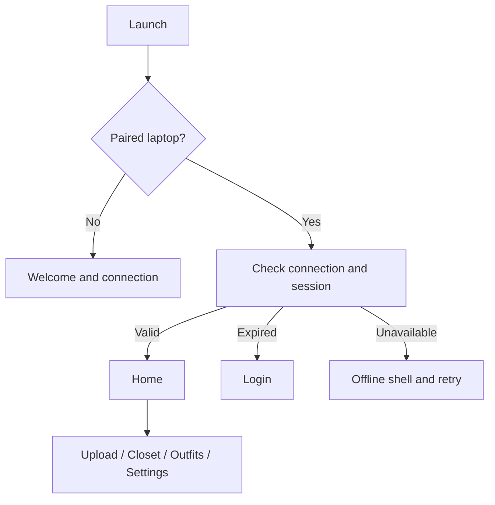

# OOTD-01 — App entry, navigation and F5 visual parity

Version 1.0 · 20 October 2026 · Owner: Product/Mobile · Status: proposed Android feature.

## 1. Overview, scope and evidence

Objective: let a wardrobe owner open the Android app, understand laptop processing, and reach the same core actions as the light F5 web interface without losing navigation state.

Pain points: desktop layouts do not fit a phone; connection failures can look like empty wardrobes; inconsistent styling makes the new app feel unrelated. Outcome: recognizable F5 appearance and a reliable path to the first upload.

Personas: first-time owner, returning signed-in owner, and owner whose laptop is asleep. In scope: launch routing, welcome/home, navigation, visual tokens and accessibility. Authentication, pairing, uploads and wardrobe content are separate features. No dark redesign, admin dashboard or cloud hosting.

Verified: `F5/static/index.html` defines OOTD, the upload hero, three explanatory cards, closet/category filters and modal entry points. Saved F5 screenshots were visually inspected. Flutter navigation and mobile layouts are proposed.

## 2. Functional requirements and acceptance criteria

| Requirement | Measurable acceptance criterion |
|---|---|
| FR1 Route by connection and session state | Fresh install opens welcome; no paired server routes to connection; valid session reaches home; expired session routes to login without displaying another account's content. |
| FR2 Preserve F5 appearance | Background `#F7F6F2`, primary `#3B5B4C`, white cards, text `#1C1D1F`, Plus Jakarta Sans and 8/14/22 dp radii match approved reference tokens. |
| FR3 Expose core navigation | Home, Closet, Outfits and Settings are reachable within two taps; Choose Photo and Use Camera remain distinct controls. |
| FR4 Preserve useful state | Android back returns to the previous screen; tab/filter/scroll state survives backgrounding; logout clears account-specific state. |
| FR5 Explain processing location truthfully | Home says “Photos processed on your laptop”; analytics consent is described separately; no “100% on-device” claim. |
| FR6 Accessible, resilient layout | At 360/412/600 dp widths and 200% text scale, primary actions remain reachable with no clipped text; touch targets at least 48 dp; TalkBack labels and non-color status cues exist. |

## 3. Application flow

1. Load app preferences and paired-server metadata locally.
2. Show home shell immediately, then probe connection and validate a stored session.
3. Route to setup/login when necessary, preserving only the intended destination, never credentials.
4. Render authenticated home actions. Navigate using stable route names.
5. On network loss show “Laptop unavailable,” retain owner-scoped cached data with a stale label, and offer retry/connection setup.

## 4. Frontend implementation

Use a declarative router and one session controller. Rebuilds must not navigate twice or emit duplicate views. Render skeletons only where data is pending; distinguish no data from unavailable data. Never show a spinner indefinitely: connection timeout leads to a recoverable state after five seconds.

Bundle licensed font assets for offline display. Preserve F5 cutout aspect ratio and generous white space; desktop modals become scrollable sheets/full screens. Use a two-column garment layout where it fits and one column under large text. Respect reduced motion. No API requests are triggered simply by layout calculations.

First frame target: under two seconds on the selected test phone, excluding network readiness. Display tap feedback within 100 ms. These are proposed targets requiring device measurement.

## 5. Backend workflow and API contracts

No new home-content endpoint or table is needed. The shell consumes two proposed contracts owned by OOTD-02 and OOTD-04. Existing F5 `GET /api/auth/me` returns `authenticated/user`; do not treat it as the new DTO.

All examples below are proposed. HTTPS, `Accept: application/json`; protected calls use bearer access tokens. Error structure is stable and contains no internal paths.

| API and request | Success example | Failure example |
|---|---|---|
| `GET /api/v1/health`; no auth/body | `200 {"server_id":"10000000-0000-4000-8000-000000000001","api_version":"1","status":"ready","ai_status":"ready"}` | `503 {"error":{"code":"SERVER_NOT_READY","message":"Laptop service is starting.","retryable":true},"request_id":"r-01"}` |
| `GET /api/v1/auth/me`; `Authorization: Bearer <access_token>`; no body | `200 {"user_id":"20000000-0000-4000-8000-000000000001","username":"alex","display_name":"Alex","version":1,"analytics_consent":false,"consent_version":1,"timezone":"Asia/Kolkata"}` | `401 {"error":{"code":"SESSION_EXPIRED","message":"Please sign in again.","retryable":false},"request_id":"r-02"}` |

Health checks return readiness only. Session checks verify signature/expiry, active server-side session and user status, then return an allowlisted profile. UUIDs do not replace authorization. A refresh attempt may occur once under OOTD-04 before redirecting. A server error must not be interpreted as logout.

## 6. Database, consistency and security

Read user/session records only through the session service. Persist navigation locally keyed by server UUID and account UUID, never username alone. Home has no write transaction. Concurrent launch callbacks share one pending session check. Caches are cleared on account or server change; no private disk images in unauthenticated home.

Use HTTPS identity validation from pairing. Redact route parameters from analytics and logs. Health can be cached for five seconds; session validity is rechecked on app resume when older than five minutes.

Observe launch latency, routing failures and invalid-route fallback locally; route exceptions show a safe home action. Target health/session checks below 500 ms p95 on LAN, excluding startup; apply their owning rate limits.

## 7. Analytics

After consent, envelope: `event_id:uuid`, `event_version:int=1`, `occurred_at:timestamp`, `distinct_id:string`, `user_id:uuid|null`, `session_id:uuid`, `platform:string="android"`, `app_version:string`, `screen_name:string`, `source:string="client"`.

| Event | Trigger | Additional typed properties |
|---|---|---|
| `screen_viewed` | Route becomes visible once | `screen_name:string`, `entry_point:enum(launch,tab,back)` |
| `get_started_tapped` | Welcome CTA | `destination:string` |
| `home_action_tapped` | Core action | `action:enum(upload,camera,closet,outfits,settings)` |
| `navigation_failed` | Router cannot open intended route | `error_code:enum`, `destination:string` |
| `navigation_retried` | Explicit retry | `destination:string`, `attempt:int` |

Example properties: `{"screen_name":"home","entry_point":"launch","platform":"android","app_version":"0.1.0","event_version":1}`; append the typed envelope above with generated IDs/time. Never capture dynamic labels or email. Dedupe by screen-visit ID plus event name. A view followed by no core action within the session is inferred inactivity, not an emitted crash/abandonment.

KPI: consented first-session activation = users who reach an upload attempt / users who view home, within 24 hours. Proposed usability target: 90% of five representative testers find upload within 10 seconds.

## 8. Test plan

| ID | Scenario; preconditions/data | Steps | Expected result | Priority/type |
|---|---|---|---|---|
| T01 | Fresh install; no local state | Launch → Get started | Connection screen; no private data | P0 functional/UI |
| T02 | Paired server; valid account A | Launch and resume twice | Home; one session check per resume policy | P0 integration |
| T03 | Expired access/refresh | Launch → protected tab | Login, safe return route retained | P0 API/security |
| T04 | Laptop off; cached A data | Launch; retry; wake laptop | Offline label, retry, then current content | P0 negative/recovery |
| T05 | Account A logged out, B logs in | Switch accounts → back | No A thumbnails, state or actions | P0 security/regression |
| T06 | Widths 360/412/600; text 200% | Traverse all home controls | No overflow; scrollable and labelled | P1 accessibility/UI |
| T07 | Keyboard and Android back | Open login; back; switch tabs | Predictable navigation; no duplicate screen | P1 functional |
| T08 | Health returns malformed JSON | Launch | Recoverable service error, not empty home | P1 contract |
| T09 | Test phone, cold start ×20 | Measure first frame/navigation | p95 first frame ≤2s; feedback ≤100ms | P1 performance |
| T10 | Consent on/off; repeated rebuilds | Visit home then rebuild ×10 | One view/visit when on, zero when off | P0 analytics |

FR1→T01–04; FR2/6→T06/09; FR3/4→T05/07; FR5→copy review and T01; analytics→T10.

## 9. Implementation, dependencies and risks

Mobile: theme tokens, bundled fonts, router/session guard, responsive home and cache boundaries. Backend: implement the consumed readiness/profile contracts and stable errors. Analytics: central route observer. QA: reference screenshots, lifecycle tests and device benchmark.

Dependencies: OOTD-02 connection, 04 session, 18 event adapter. Risks: source screenshots differ from current HTML; large text changes card layout; unknown device performance. Open: final app name/package and minimum supported Android. Use OOTD as a working name.

## 10. Release readiness

- [ ] FR1–FR6 pass with corresponding tests.
- [ ] F5 visual comparison approved at target widths.
- [ ] No private content before authentication or after logout.
- [ ] Failure messages, back behavior and consented events verified.
- [ ] Device performance measured; open branding/device decisions resolved.
