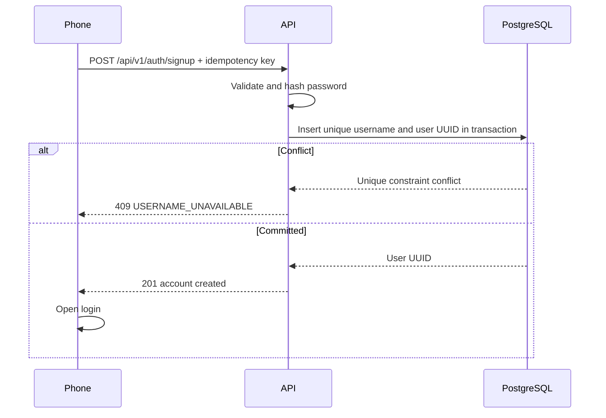

# OOTD-03 — Account registration

Version 1.0 · 20 October 2026 · Owner: Product/Auth · Status: proposed.

## 1. Overview and scope

Objective: create a distinct SQL-backed wardrobe identity without conflating a username with a permanent ID. Personas: new household member and owner checking whether an imported F5 account already exists. Pain: duplicate identities, confusing signup failures and loss of data ownership.

In scope: username/password/display-name registration, validation, unique UUID creation and explicit handoff to login. No email/SMS verification, social login or password reset. Existing F5 users sign in through OOTD-04 after OOTD-19 import.

Verified: F5 `POST /api/auth/register` stores case-insensitive usernames and PBKDF2 hashes, returns an integer ID and session token. The proposed `/api/v1` registration does **not** auto-login; this avoids replaying session secrets through idempotency storage.

## 2. Requirements and acceptance

| Requirement | Acceptance criterion |
|---|---|
| FR1 Validate identity | New username: 3–32 ASCII letters/digits/underscore/dot/hyphen, case-insensitive; display name 1–60 trimmed characters. Errors attach to fields. |
| FR2 Protect passwords | New password 10–128 characters; spaces preserved; confirmation matches locally; server stores only a modern password hash, never confirmation or plaintext. |
| FR3 Create exactly one account | Concurrent submissions for normalized username create one UUID row; retries with the same idempotency key return the same successful account reference. |
| FR4 Preserve imported identities | Existing F5 usernames remain reserved; user is directed to login; imported accounts are never silently replaced. |
| FR5 Give truthful success/failure | Success shown only after committed DB transaction; timeout supports safe retry; API outage does not claim username is unavailable. |
| FR6 Minimize data and consent | Optional analytics choice is separate and off by default; email and phone are not required. |

## 3. Flow

Connected laptop → Create account → enter fields → client validation → idempotent registration → committed UUID response → confirmation → login with username prefilled and password cleared.



## 4. Frontend

Use F5 light auth form, visible labels, password visibility control and keyboard-aware scrolling. Validate on submit and after a field has been touched; do not trim passwords. Disable the submit button while pending. Preserve non-secret fields across retries; avoid persisting password to disk or navigation state.

Loading: button spinner. Success: “Account created. Sign in to continue.” Duplicate: “Username unavailable. Try another or sign in.” Timeout: “We couldn't confirm creation. Retry safely.” No empty state other than initial form. Back during request stops navigation but does not assume server cancellation; the same key reconciles later.

48 dp controls, TalkBack error focus, 200% text support. Local validation/feedback <100ms; no password rules conveyed by color alone.

## 5. Backend and API

All target contracts proposed. HTTPS; `Content-Type: application/json`; no authentication; `Idempotency-Key` UUID required. Proposed signup limit 3/minute per network client and bounded hash work; only trust proxy IP headers from configured proxies.

```http
POST /api/v1/auth/signup
Idempotency-Key: 90000000-0000-4000-8000-000000000001
Content-Type: application/json

{"username":"alex_new","display_name":"Alex","password":"Example-only-passphrase-42","analytics_consent":false}

201 Created
{"user_id":"20000000-0000-4000-8000-000000000001","username":"alex_new","next_action":"login"}
```

Failure example (`409`):

```json
{"error":{"code":"USERNAME_UNAVAILABLE","message":"Choose another username or sign in.","retryable":false},"request_id":"r-30"}
```

Other errors: `422 VALIDATION_ERROR` with allowlisted `fields:[{field,code}]`; `429 RATE_LIMITED` plus Retry-After; `503 DATABASE_UNAVAILABLE`; changed idempotency payload `409 IDEMPOTENCY_CONFLICT`.

Workflow: reject oversized bodies (>8 KiB), validate Unicode/control rules and normalized username, acquire idempotency reservation, hash using Argon2id with benchmarked parameters, insert user/preferences/outbox and finalize response atomically. Use a unique normalized-username constraint, not only a precheck. Do not log request bodies or use raw password bytes as persisted idempotency fingerprint; HMAC the canonical payload with a server-held key and short retention. Drop hash-work results on failure; never persist a partial account.

## 6. Data and integrations

Proposed PostgreSQL `users(user_id uuid PK, username text, username_normalized text UNIQUE, display_name text, password_hash text, password_scheme text, status text, version int, analytics_consent bool, consent_version int, created_at timestamptz)`; migration 19 owns schema. New users use `password_scheme=argon2id`; imported legacy users are handled separately. Backend derives user UUID, not the client.

Idempotency for unauthenticated signup is scoped to this operation/key and a cryptographic payload digest, with rate limits to prevent abuse. Outbox events omit username/password. Analytics failure cannot roll back account creation.

Observability: count validation, conflicts, hash latency, DB failures; audit account UUID and request ID after successful creation. Target p95 ≤1.5s warm LAN including password hashing under low load; alert on repeated DB failures. No auto-retry of invalid input; clients retry network errors only with the original key.

## 7. Analytics

Consented common envelope: event UUID/version, UTC timestamp, anonymous/account distinct ID, nullable user UUID, app session UUID, Android/app version, screen, source. Only identify a new account after successful authentication, not on signup submission.

| Event | Producer/trigger | Extra properties |
|---|---|---|
| `signup_submitted` | Client valid form sent | `operation_id:uuid`, `attempt:int` |
| `signup_succeeded` | Server committed creation, only if consent permits | `operation_id:uuid`, `duration_ms:int` |
| `signup_failed` | Client receives terminal error | `operation_id:uuid`, `error_code:enum` |
| `signup_retried` | User retries same operation | `attempt:int`, `operation_id:uuid` |
| `signup_abandoned` | User explicitly leaves touched form | `stage:enum(editing,submitted)` |

Example: `{"event":"signup_failed","properties":{"operation_id":"90000000-0000-4000-8000-000000000001","error_code":"USERNAME_UNAVAILABLE","attempt":1}}` with envelope. No field values. Server outcome has one deterministic event ID per creation; client does not emit a second signup success. Inferred abandonment = no creation in 30 minutes; distinguish unresolved network outcomes.

KPI: committed signups / valid submitted operations in a 30-minute window, restricted to consented traffic. Target zero duplicate account rows and zero sensitive fields in events.

## 8. Tests

| ID | Preconditions/data | Steps | Expected | Priority/type |
|---|---|---|---|---|
| T01 | Unique valid username/password | Submit → login handoff | One UUID user, no issued session | P0 functional/API |
| T02 | Empty/2/33-char username; invalid characters | Submit each | 422 and field guidance; no row | P0 negative |
| T03 | Passwords with spaces and 9/10/128/129 chars | Submit; later login | Boundaries enforced, spaces preserved | P0 security |
| T04 | Imported username `alex` exists | Submit `Alex` | Conflict, source account unchanged | P0 migration/regression |
| T05 | Two concurrent same usernames | Submit simultaneously | One committed account | P0 concurrency |
| T06 | Response lost after commit | Retry same key/body | Same user UUID; no duplicate event | P0 recovery |
| T07 | Same key different body | Replay changed username | 409; no second mutation | P0 API |
| T08 | DB down or hash overload | Submit, exceed rate | 503/429 with safe recovery | P1 integration/performance |
| T09 | TalkBack/keyboard/large text | Fill and correct errors | Focus and submit accessible | P1 UI |
| T10 | Consent off/on; inspect logs/events | Register synthetic account | No secrets; consent and one outcome enforced | P0 analytics/security |

FR1→T01/02/04; FR2→T03/10; FR3→T05–07; FR4→T04; FR5→T06/08; FR6→T10.

## 9. Tasks, dependencies and decisions

Frontend: accessible registration form, operation-key lifecycle, login handoff. Backend: validation, hash policy, uniqueness, transaction/outbox, throttling. Database: 19 users/idempotency migrations. Analytics: 18 adapter and consent. QA: concurrent signup and timeout reconciliation.

Risks: legacy usernames may not satisfy new signup rules; allow imported identifiers for login without forcing renaming. Open: final hashing parameters after laptop benchmark. Username/password is proposed for F5 compatibility; email-based registration would be a separate product change.

## 10. Release readiness

- [ ] FR1–FR6 and T01–T10 pass.
- [ ] No plaintext password in DB/logs/events/idempotency responses.
- [ ] Imported usernames cannot be overwritten.
- [ ] API/field validation and accessible errors agree.
- [ ] Consent and uniqueness survive retries.
