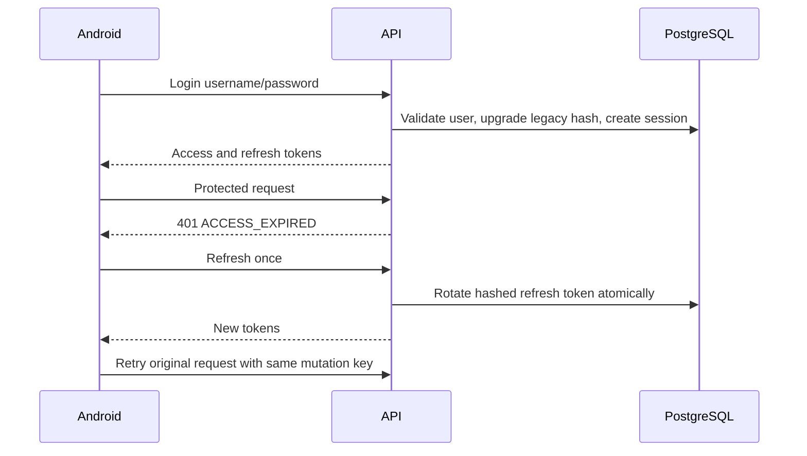

# OOTD-04 — Login, session lifecycle and logout

Version 1.0 · 20 October 2026 · Owner: Auth/Mobile · Status: proposed.

## 1. Overview and scope

Objective: authenticate each wardrobe owner on Android, retain a safe per-device session and end it predictably. Personas: new user, imported F5 user, and owner of two phones. Pain: expired requests, shared prototype tokens and accidental cross-account caches.

In scope: username/password login, refresh, session validation and logout. Out: recovery/email/SMS/biometrics, social login and account merging. Verified F5 uses a single reusable `users.token`, no server-side expiry check, and PBKDF2-SHA256. These are source facts; new token/session design below is proposed.

## 2. Requirements and acceptance

| Requirement | Acceptance criterion |
|---|---|
| FR1 Authenticate safely | Correct active account succeeds; unknown username and wrong password both return generic 401; passwords never appear in logs/events. |
| FR2 Preserve imported access | Verify F5 legacy hash with recorded parameters; upgrade hash on successful login without changing account UUID/ownership. |
| FR3 Isolate devices | Each login creates a distinct session; 15-minute access token and rotating 30-day refresh token are proposed lifetimes; revoking one session leaves another intact. |
| FR4 Recover expiry | Client performs one serialized refresh, retries eligible pending requests once, and opens login if refresh fails; no refresh storm. |
| FR5 End session and identity | Logout clears phone tokens/private caches immediately and revokes server session when connected; subsequent API use with it fails. |
| FR6 Protect persisted credentials | Refresh token stored using Android-backed secure storage; access token in memory; no auth secrets in QR, analytics or ordinary preferences. |

## 3. Flow

Paired laptop → login → validate/historical hash upgrade → tokens → identify consented analytics → home. Resume checks `/auth/me`. On access expiry perform serialized refresh. Logout revokes the device session and resets local user data and analytics identity.

## 4. Frontend

F5 light sign-in form, username and password, clear generic error, password visibility and “Create account.” No nonfunctional forgot-password link. Imported accounts use the old username; new password rules must not reject a legacy password before verification.

Do not trim new passwords. F5 historically trimmed at its API boundary; only a `legacy_f5` verifier may apply that legacy normalization, then require an explicit new password in a future change flow if needed. Do not silently alter the meaning of a modern password.

Prevent duplicate submit and parallel refresh. Store session by paired server UUID/account UUID. During refresh, queued reads wait; mutations retain original idempotency keys. Offline logout clears local data immediately, with a queued revocation token kept only in encrypted isolated storage until retry or expiry. UI states that server revocation is pending; a local wipe alone is not claimed to revoke server credentials.

## 5. Proposed API contracts and workflow

HTTPS JSON; `Accept/Content-Type: application/json`. Login/refresh do not require access auth. Me/logout require bearer auth except logout also accepts a refresh-token revocation body when access expired. Tokens below are placeholders, not real credentials.

| API; request | Success example | Failure example |
|---|---|---|
| `POST /api/v1/auth/login` `{"username":"alex","password":"example legacy password","device_label":"Android phone"}` | `200 {"user_id":"20000000-0000-4000-8000-000000000001","session_id":"30000000-0000-4000-8000-000000000001","access_token":"<access>","refresh_token":"<refresh>","expires_in":900}` | `401 {"error":{"code":"INVALID_CREDENTIALS","message":"Username or password is incorrect.","retryable":false},"request_id":"r-40"}` |
| `POST /api/v1/auth/refresh` `{"refresh_token":"<refresh>"}` | `200 {"access_token":"<new-access>","refresh_token":"<new-refresh>","expires_in":900}` | `401 {"error":{"code":"SESSION_EXPIRED","message":"Please sign in again.","retryable":false},"request_id":"r-41"}` |
| `GET /api/v1/auth/me` bearer; no body | `200 {"user_id":"20000000-0000-4000-8000-000000000001","username":"alex","display_name":"Alex","version":1,"analytics_consent":false,"consent_version":1,"timezone":"Asia/Kolkata"}` | `401 {"error":{"code":"ACCESS_EXPIRED","message":"Session needs renewal.","retryable":false},"request_id":"r-42"}` |
| `POST /api/v1/auth/logout` bearer or `{"refresh_token":"<refresh>"}` | `200 {"logged_out":true}` even if already revoked | `503 {"error":{"code":"REVOCATION_UNAVAILABLE","message":"Signed out on this phone; server confirmation is pending.","retryable":true},"request_id":"r-43"}` |

Validation: ≤8 KiB bodies; normalized username lookup; constant-time hash verification; inactive accounts rejected. Login limit proposed 5/minute per account key plus network controls; 429 Retry-After. Create tokens only after DB session commit. JWT claims: subject UUID, server audience, session UUID and expiry; verify algorithm/issuer/audience explicitly. Check active session on protected calls so revocation takes effect immediately. Profile `timezone` is a required response key but may be null until selected; a null timezone does not block login, only date-sensitive wear recording.

Refresh transaction locks session row, verifies hashed token and expiry, rotates token atomically, records previous-token invalidation. No secret response in idempotency cache. Lost refresh response means re-login is acceptable; do not retry consumed refresh tokens indefinitely. Client serialized refresh is required. Unknown logout token returns success without disclosing account existence.

## 6. Data, security and observability

Proposed `auth_sessions(session_id uuid PK,user_id uuid FK,refresh_hash text,expires_at timestamptz,revoked_at timestamptz null,rotation int,created_at timestamptz)`; `users.password_scheme` supports legacy PBKDF2 metadata until upgrade. Never import F5 session tokens. Hash upgrade and login session creation share one transaction.

Validate ownership on every dependent request. Do not infer ownership from analytics identity. Audit login outcome codes/session UUID, never username/password/token. Metrics: login/refresh failures, rehash time and revocation delay. Alert on repeated DB/auth infrastructure failure, not every bad password. Proposed p95 login ≤1.5s, refresh ≤500ms warm LAN. No caching of secret login responses.

## 7. Analytics

Envelope after consent: event UUID/version, UTC time, `distinct_id`, nullable `user_id`, app analytics session UUID, Android/app version, screen/source. Authentication `session_id` is never used as analytics session ID or sent to PostHog.

| Event | Trigger | Typed properties |
|---|---|---|
| `login_submitted` | Client valid submit | `operation_id:uuid`, `attempt:int` |
| `login_succeeded` | Server creates device session with permitted consent | `operation_id:uuid`, `legacy_upgrade:bool`, `duration_ms:int` |
| `login_failed` | Client terminal response | `error_code:enum`, `attempt:int` |
| `login_retried` / `login_abandoned` | Explicit retry/exit | `operation_id:uuid`, `stage:enum` |
| `session_refresh_failed` | Refresh cannot recover | `error_code:enum` |
| `logout_tapped` / `logout_succeeded` | Client intent / server revocation | `revocation_pending:bool` for client intent |

Example properties: `{"operation_id":"90000000-0000-4000-8000-000000000004","legacy_upgrade":true,"duration_ms":420}`. Preserve captured event identity through delivery, reset on logout, and never identify based on submitted username. One success per committed session; counts deduped by event UUID.

KPI: successful logins / submitted operations within five minutes; refresh recovery rate; local logout privacy failures target zero. Account/session UUIDs in operational DB are separate from marketing attribution.

## 8. Tests

| ID | Preconditions/data | Steps | Expected | Priority/type |
|---|---|---|---|---|
| T01 | Active modern user | Login → me | Correct UUID/profile, new device session | P0 API/functional |
| T02 | Unknown user/wrong password | Try both | Same generic 401 schema | P0 security |
| T03 | Imported F5 hash, whitespace legacy case | Login; inspect hash scheme | Access preserved, modern rehash, same owner | P0 migration/regression |
| T04 | Two phones same account | Login both; logout one | Only target session revoked | P0 integration |
| T05 | Expired access; five parallel reads | Trigger all | One refresh, each retried once | P0 concurrency |
| T06 | Lost rotation response | Refresh; drop response; resume | Re-login safely; no endless loop | P0 recovery |
| T07 | Laptop offline on logout | Logout; restart; reconnect | No local private content; deferred revocation | P0 security/recovery |
| T08 | Modified JWT, wrong server audience | Request me/media | Rejected before private response | P0 security |
| T09 | Rate limit and slow hash | Burst attempts; measure | 429, bounded hash load, latency target | P1 performance |
| T10 | Account A logout/B login; consent combinations | Inspect cache/analytics | No identity or media crossover | P0 analytics/UI |

FR1→T01/02/08/09; FR2→T03; FR3→T04; FR4→T05/06; FR5/6→T07/10 plus storage inspection.

## 9. Tasks, risks and dependencies

Backend: legacy verifier, rehash, sessions, JWT validation, refresh locks and audit. Mobile: secure storage, serialized refresh, account switch cleanup. Database: OOTD-19 migration and session indexes. Analytics: 18 identify/reset and event outbox. QA: physical device keystore and offline/logout tests.

Open: final token lifetimes and hash benchmark; these proposed values are explicit defaults. Weak F5 demo credentials must be quarantined/disabled by migration, not accepted as a public account. Password recovery is excluded and must not be promised in UI.

## 10. Release readiness

- [ ] Legacy and modern account tests pass.
- [ ] No imported tokens; per-device revocation demonstrated.
- [ ] Secure storage, audience checks and generic errors verified.
- [ ] Refresh/lost-response/offline logout handled.
- [ ] Analytics identity resets without exposing auth secrets.
