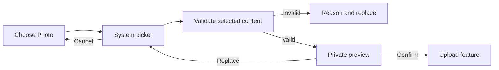

# OOTD-05 — Gallery photo selection

Version 1.0 · 20 October 2026 · Owner: Mobile · Status: proposed Android feature.

## 1. Overview and scope

Objective: select and preview one existing photo without uploading anything until the user confirms. Persona: owner with outfit or flat-lay photos. Pain: accidental uploads, unsupported formats and losing a selection after leaving the app.

In scope: system photo picker, image preview, replacement, cancellation and private temporary draft. Out: multi-select, gallery indexing, editing/cropping, background library sync and AI. Existing F5 has a file input accepting `image/*`; it does not provide a verified Android picker implementation.

## 2. Requirements and acceptance

| Requirement | Acceptance criterion |
|---|---|
| FR1 Select one photo | Choose Photo opens system picker; selecting one image returns to preview; cancel creates no upload or extraction. |
| FR2 Validate before confirmation | JPEG/PNG/WebP, ≤15 MiB and ≤50 megapixels are proposed v1 limits; invalid/decode-failed files show a reason and Replace action. Backend repeats validation. |
| FR3 Preserve orientation and preview | EXIF rotation displays correctly; no stretching; original bytes are not altered silently for analysis parity. |
| FR4 Retain private draft | App background/process recreation restores an accessible draft or asks to select again; temporary file is scoped to server/account and expires after 24h. |
| FR5 Respect user control | Replace discards previous draft; Confirm hands off exactly once; Back asks before discarding a selected image. |
| FR6 Minimize access | Only selected content is read; no broad gallery scan, filename analytics or private preview after logout. |

## 3. Flow and states

Home → Choose Photo → OS picker → read selected URI → bounded validation/thumbnail → preview → confirm → OOTD-07 upload. Authentication is checked at handoff; a selected draft can survive a login navigation only under the same local intended account context, never across account switches.



Loading: decoding indicator, cancel available. Empty: no selection. Success: preview with upload action. Error: unsupported/too large/access expired/cloud source unavailable. Do not label picker cancellation as failure.

## 4. Frontend

Use the F5 light upload card, sage Choose Photo button and contained image preview. Android picker URI may not be a filesystem path. Read through the platform abstraction, copy only selected bytes into app-private staging if needed, cap streaming bytes and thumbnail resolution to avoid memory spikes. Treat HEIC as unsupported unless a separately tested conversion is added with explicit user notice.

Persist draft metadata and URI grant only as supported by the chosen plugin; recover picker lost-data results after Android activity destruction. Prevent stale picker responses replacing a newer draft using selection operation IDs. Show dimensions/size, not a raw local path. Touch targets ≥48 dp, descriptive preview semantics and TalkBack cancellation feedback.

Target picker return-to-thumbnail p95 ≤1s for ≤15 MiB on target phone; decode off the UI thread. Never block app startup to decode a draft.

## 5. Backend responsibilities and integration contract

This feature makes **no backend API request**. There is no gallery-list endpoint or DB table. Backend work is an explicit dependency: OOTD-07 must revalidate all uploaded bytes; client approval is untrusted.

Proposed internal handoff, not an HTTP endpoint:

```json
{"draft_id":"40000000-0000-4000-8000-000000000005","source":"gallery","mime_type":"image/jpeg","size_bytes":287550,"width":1200,"height":1600,"private_file_ref":"app-private-selected-photo","orientation_applied_to_preview":true}
```

Native failure example:

```json
{"code":"PHOTO_ACCESS_EXPIRED","message":"Select this photo again.","retryable":true}
```

Confirmation invokes upload with the draft bytes and a new persisted operation UUID; paths never leave the device. No automatic retry of OS picker actions. If the draft disappears, return to selection; do not send a zero-byte request. Authentication and authorization are enforced by the later upload API, not by trusting draft metadata.

## 6. Data, consistency, security and observability

Local record: draft UUID, source, private reference, MIME, dimensions, byte count, owner/server binding, created/expiry time. No SQL migration. Delete abandoned drafts after 24h and on logout/account/server switch. Do not delete the user's original gallery photo.

Duplicate native callbacks are ignored by draft operation ID. Keep only one current draft per upload flow. No third-party image service or remote thumbnail generation.

Operational logs contain decode duration, bytes bucket and allowlisted errors; never URI, filename, EXIF or pixels. Memory target: no full-resolution duplicate buffers retained after preview. No network rate limits apply; picker launch is disabled while already active.

## 7. Analytics

Consented envelope: `event_id:uuid`, `event_version:1`, UTC time, anonymous/account distinct ID, nullable user UUID, app session UUID, Android/app version, screen/source. All properties below are safe metadata; no content.

| Event | Trigger | Typed properties |
|---|---|---|
| `gallery_picker_tapped` | OS picker launched | `operation_id:uuid`, `entry_point:string` |
| `photo_selected` | Valid selection ready | `operation_id:uuid`, `source:enum(gallery)`, `size_bucket:enum`, `format:enum` |
| `photo_selection_cancelled` | OS cancellation or explicit discard | `reason:enum(picker_cancel,discard)` |
| `photo_selection_failed` | Native/validation error | `error_code:enum`, `retryable:bool` |
| `photo_selection_retried` | Replace after error | `attempt:int`, `operation_id:uuid` |

Example: `{"source":"gallery","size_bucket":"under_1mb","format":"jpeg","entry_point":"home"}` plus envelope. Dedupe native callbacks by operation ID/event; account identity is captured at event creation. Abandonment after selection is inferred when no upload starts within 30 minutes, not emitted on every background transition.

KPI: valid selections / picker launches, cancel rate and validation failures by format. Target zero network uploads before confirmation.

## 8. Tests

| ID | Preconditions/test data | Steps | Expected | Priority/type |
|---|---|---|---|---|
| T01 | Valid JPEG in gallery | Pick → preview → confirm | Correct draft, one upload handoff | P0 functional |
| T02 | Picker open | Cancel | Home, zero API requests | P0 negative/UI |
| T03 | PNG/WebP/JPEG EXIF rotations | Pick each | Correct aspect/orientation | P1 regression |
| T04 | >15 MiB, >50MP, corrupt/HEIC | Pick each | Specific rejection, no upload | P0 validation |
| T05 | Cloud-only photo, network off | Select | Recoverable acquisition error | P1 integration |
| T06 | Activity killed during picker | Return/relaunch | Recover result or request selection | P0 lifecycle |
| T07 | Stale URI/removed file | Resume → confirm | Select again, no empty upload | P0 recovery |
| T08 | Draft A, logout/login B | Open preview | A draft cleared/unavailable | P0 security |
| T09 | Rapid selection/duplicate callbacks | Select/replace quickly | Last draft only, one event | P1 concurrency/analytics |
| T10 | Largest valid image; large text/TalkBack | Preview and navigate | Target latency, bounded memory, reachable controls | P1 performance/accessibility |

FR1/5→T01/02/09; FR2→T04; FR3→T03; FR4→T06/07; FR6→T08/10 and network inspection.

## 9. Implementation and dependencies

Mobile: picker adapter, private draft repository, validation, thumbnail preview, lost-result recovery. Backend: no new endpoint; upload validator remains mandatory. Analytics: 18 central capture. QA: OEM picker and actual phone media cases.

Dependencies: 01 entry, 04 identity boundaries, 07 upload. Open: phone model and plugin compatibility with its Android version. Limits are proposed and must agree with health/config and server validation.

## 10. Release readiness

- [ ] Supported formats, rotation, cancellation and lifecycle verified.
- [ ] Original gallery files never modified/deleted.
- [ ] No pre-confirmation network traffic or leaked image metadata.
- [ ] Draft cleanup and consented event deduplication pass.
- [ ] Upload handoff works on actual phone.
