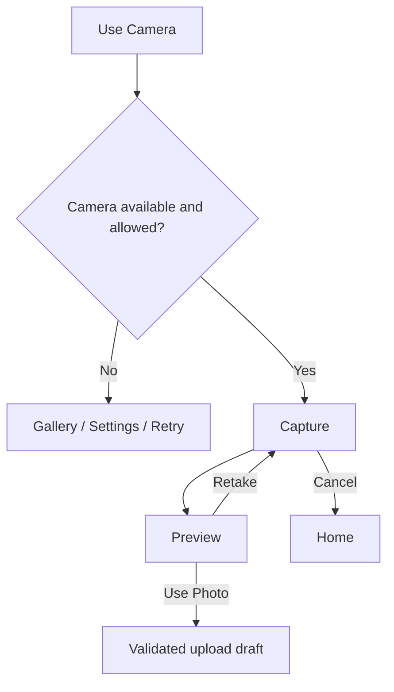

# OOTD-06 — Camera capture

Version 1.0 · 20 October 2026 · Owner: Mobile · Status: proposed separate increment.

## 1. Overview and scope

Objective: take an outfit/flat-lay photo and intentionally hand it to the existing upload flow. Persona: owner adding clothes without a saved photograph. Pain: permission denial, accidental capture submission and losing camera results.

In scope: rear-camera capture, permission handling, preview/retake/use, local staging. Out: video, live segmentation, continuous capture, camera filters and background capture. F5 exposes Use Camera via a browser file input; this is evidence of product intent, not native Android support.

## 2. Requirements and acceptance

| Requirement | Acceptance criterion |
|---|---|
| FR1 Request only needed access | Camera access is requested only on Use Camera where the chosen capture integration requires it; denial offers gallery and Settings guidance. |
| FR2 Capture intentionally | One shutter/capture result creates one draft; photo is never uploaded until Use Photo. |
| FR3 Preview and retake | Preview respects orientation; Retake deletes only the app's temporary rejected capture; gallery originals remain untouched. |
| FR4 Recover lifecycle | Rotation, backgrounding and process recreation restore the pending result or a clear retry state. |
| FR5 Share upload constraints | Valid JPEG/PNG/WebP, ≤15 MiB and ≤50MP; incompatible result receives a recoverable error, with no silent quality change. |
| FR6 Preserve accessibility/privacy | Capture prompts accessible; no EXIF/location/pixels in analytics; account switch clears draft; no microphone permission. |

## 3. Flow

Home Use Camera → permission/system capture → photo result → private preview → Retake or Use Photo → OOTD-07. A tutorial suggests full garments and even light without promising model accuracy.



Empty: no capture. Loading: camera initialization/result read. Errors: denied, unavailable, cancelled, no storage, invalid image or lost result. Cancellation is a normal exit.

## 4. Frontend

Use Android capture through a tested Flutter plugin; release permissions must match the selected integration, not a blanket manifest request. Rear camera is initial preference; respect platform availability. Show a progress state while returning from the camera and bound image decode memory. Do not force-save captures to public gallery without a separate explicit user action.

F5 light preview card, sage Use Photo and secondary Retake. Disable repeated launch while camera is active. Persist a pending-capture ID before launch. OEM result callbacks are deduped by this ID. Back cancels preview with discard confirmation only when a valid draft exists.

Target return-to-preview p95 ≤1.5s for supported image sizes, measured separately from camera shutter delay. Test TalkBack, 200% text and 48 dp controls.

## 5. Backend and handoff contract

No camera-control HTTP endpoint or camera database is required. Capture is device-local. The server must still decode/validate uploaded bytes and strip metadata during OOTD-07, because cameras can return unexpected formats.

Proposed internal success:

```json
{"draft_id":"40000000-0000-4000-8000-000000000006","source":"camera","mime_type":"image/jpeg","size_bytes":3200000,"width":3024,"height":4032,"private_file_ref":"app-private-capture"}
```

Proposed native failure:

```json
{"code":"CAMERA_PERMISSION_DENIED","message":"Allow camera access or choose a photo from your gallery.","retryable":false}
```

No backend authentication is needed to open the camera; upload requires a paired authenticated session. A capture cannot be attached to another user's pending upload. Client should not retry OS capture automatically after cancellation. When the app resumes with a missing temporary file, ask to retake, never post a fabricated empty image.

## 6. Data, consistency and operations

Store temporary draft UUID/path privately, source, orientation, size, owner/server binding and 24h expiry. No SQL change. Cancel/retake removes only validated app-private temporary paths. On logout clear drafts and captured thumbnails.

Camera unavailable does not disable gallery upload. Local diagnostic logs count capture outcomes/latency without device photo metadata. Permission-denied frequency is a UX metric, not a server alert. No service rate limit; one active camera operation per app.

## 7. Analytics

Consented envelope: event UUID/version/time, distinct ID, nullable user UUID, app session UUID, platform/app version/screen/source. Identity is frozen when the event is queued.

| Event | Trigger | Typed properties |
|---|---|---|
| `camera_tapped` | Start capture intent | `operation_id:uuid`, `entry_point:string` |
| `camera_capture_succeeded` | Valid preview ready | `operation_id:uuid`, `size_bucket:enum`, `format:enum` |
| `camera_capture_failed` | Terminal platform/validation error | `error_code:enum`, `permission_state:enum` |
| `camera_retake_tapped` | Retake action | `operation_id:uuid`, `attempt:int` |
| `camera_capture_cancelled` | Explicit camera/preview cancel | `stage:enum(camera,preview)` |
| `photo_selected` | Use Photo handoff | `source:"camera"`, `operation_id:uuid` |

Example properties: `{"error_code":"CAMERA_UNAVAILABLE","permission_state":"granted","attempt":1}`. One success per capture, one selection per accepted draft. Infer drop-off if capture preview has no accepted selection within 30 minutes; do not interpret every background event as abandonment.

KPI: accepted photos / camera starts, permission-denial recovery to gallery and retake rate. Proposed target: every denial has a working alternate path.

## 8. Tests

| ID | Preconditions/data | Steps | Expected | Priority/type |
|---|---|---|---|---|
| T01 | Camera available, first use | Grant → capture → Use Photo | One draft/handoff, no premature upload | P0 functional |
| T02 | Permission denied/permanent denial | Tap camera twice | Clear guidance, gallery works | P0 negative |
| T03 | Valid temporary capture | Retake then cancel | Old temporary data removed, no server request | P0 privacy |
| T04 | Orientation changes/front-return metadata | Capture portrait/landscape | Correct preview | P1 UI/regression |
| T05 | Android activity/process killed | Capture then restore | Lost-result recovery or clear retake | P0 lifecycle |
| T06 | No camera or camera busy | Start capture | Recoverable message; no stuck spinner | P1 integration |
| T07 | Disk full/oversized/corrupt result | Simulate each | Safe error and no zero-byte handoff | P0 negative |
| T08 | Account switches with draft | Logout A/login B | No A photo visible/uploadable | P0 security |
| T09 | Duplicate result callback, double Use Photo | Trigger twice | One upload operation/event | P0 concurrency/analytics |
| T10 | Maximum supported photo; TalkBack | Capture and preview | Bounded memory/latency; accessible controls | P1 performance/UI |

FR1→T02/06; FR2→T01/09; FR3→T03/04; FR4→T05; FR5→T07/10; FR6→T08/10 and event inspection.

## 9. Tasks and dependencies

Mobile: platform capture adapter, permission routes, lost-result recovery, preview, cleanup. Backend: reuse 07 validation; no new camera service. Analytics: 18 event schema. QA: physical target phone and OEM capture app.

Depends on 01, 04 identity boundaries, 05 shared draft model, 07 upload. Release can stage gallery first while hiding camera until this PRD passes. Open: native capture approach and device capabilities.

## 10. Release readiness

- [ ] Capture/retake/cancel and permission alternatives pass on device.
- [ ] No microphone/gallery-wide permission or unexpected public save.
- [ ] Lifecycle and duplicate callbacks verified.
- [ ] Photo privacy and analytics consent checks pass.
- [ ] Camera CTA exposed only when this increment is tested.
