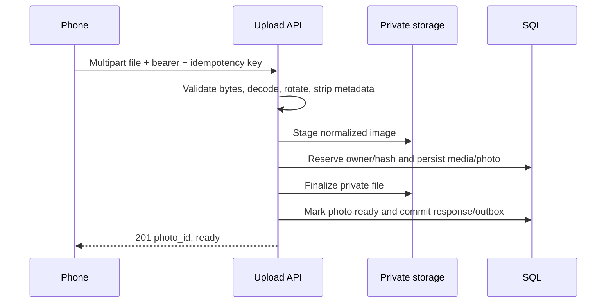

# OOTD-07 — Authenticated photo upload

Version 1.0 · 20 October 2026 · Owner: Backend/Mobile · Status: proposed.

## 1. Overview and scope

Objective: transfer a confirmed photo to the paired laptop exactly once per operation, validate it, and return a private durable photo identity. Persona: signed-in owner on unreliable Wi-Fi. Pain: duplicate files, timeouts, unsafe inputs and accidental exposure.

In scope: multipart transfer, byte progress, validation, metadata sanitation, owner-specific storage and retry reconciliation. Out: resumable chunks, multi-file upload and extraction itself.

Verified F5 `POST /api/extract` reads/saves raw bytes then performs synchronous extraction; no separate durable upload API. `wardrobe/backend/storage.py` contains validation examples but is not the selected data source. All `/api/v1` contracts below are proposed.

## 2. Requirements and acceptance

| Requirement | Acceptance criterion |
|---|---|
| FR1 Authenticate ownership | User UUID comes only from a validated bearer session; uploaded media/row belong to that account. |
| FR2 Validate defensively | Stream ≤15 MiB, allow JPEG/PNG/WebP only after decoding, reject >50MP or invalid images, apply EXIF orientation and remove metadata. |
| FR3 Reconcile retries | Same key/body yields same photo UUID; changed body/key collision returns 409; no repeated storage for identical normalized owner-scoped content. |
| FR4 Show real progress | UI shows bytes sent and then server validation, never calls upload completion “AI finished.” |
| FR5 Handle failure/cancellation | Network timeout retains draft/key for retry; local cancel stops transfer but reconciles any completed server write. |
| FR6 Publish only committed uploads | Ready response means DB/media consistent and readable by owner; partial files remain inaccessible and are cleaned safely. |

## 3. Flow

Confirm draft → validate session → create operation/key → stream multipart → server validates/sanitizes → stage private file → atomic metadata publication → return photo UUID → start extraction or manual-save flow.



## 4. Frontend

F5 light preview/progress card, cancel and retry. Persist key and local draft before first request. Connection timeout 5s; upload idle timeout 30s, overall transfer timeout 120s proposed; server acceptance is resolved via retry using the same key after ambiguous timeout. Do not auto-select a new photo or key on network errors.

Pause heavy work when backgrounded; v1 does not promise guaranteed background transfer. After activity recreation, expose retry. If auth refresh fails, preserve only owner-bound draft and route to login. Different user login discards it. No server file path is accepted from the UI.

## 5. Proposed API and backend

`POST /api/v1/photos`; HTTPS, bearer auth, `Idempotency-Key` UUID, multipart `file` plus `source=gallery|camera|manual`. No client `user_id`; server rejects unknown ownership/path fields. Maximum one file.

```http
POST /api/v1/photos
Authorization: Bearer <access_token>
Idempotency-Key: 90000000-0000-4000-8000-000000000007
Content-Type: multipart/form-data; boundary=sample

file: outfit.jpg (image/jpeg, 287550 bytes)
source: gallery

201 Created
{"photo_id":"40000000-0000-4000-8000-000000000001","media_id":"80000000-0000-4000-8000-000000000001","status":"ready","width":1200,"height":1600,"duplicate":false}
```

Failure (`413`):

```json
{"error":{"code":"PHOTO_TOO_LARGE","message":"Choose an image up to 15 MB.","retryable":false},"request_id":"r-70"}
```

Other outcomes: `401 ACCESS_EXPIRED`, `415 UNSUPPORTED_IMAGE`, `422 INVALID_IMAGE`/`RESOLUTION_LIMIT`, `409 IDEMPOTENCY_CONFLICT`, `429 UPLOAD_LIMIT`, `503 STORAGE_UNAVAILABLE`/`DATABASE_UNAVAILABLE`. Same-key replay returns the stored original response; new-key same-content request may return `200` with `duplicate:true` and existing photo ID.

Workflow: enforce authenticated active owner and request limits before buffering; bounded streaming; reject decoder bombs and multiple frames; decode off the async event loop; normalize orientation/color mode and strip metadata. For AI parity preserve pixel information with lossless normalized storage; do not silently JPEG-recompress as the other prototype does. New normalization requires regression fixtures.

Generate filenames from UUIDs/server content hash, never client path. Hash normalized pixels plus dimensions/mode with owner-scoped uniqueness. Stage file, reserve DB row, atomically move to final private location, mark ready. A reconciliation task removes unreferenced staging files and resolves interrupted publications; no response may claim ready with missing file.

## 6. Database, consistency and operations

Proposed `photos(photo_id uuid PK,user_id uuid FK,media_id uuid FK,content_hash text,status text,source text,width int,height int,created_at timestamptz)` and `media(media_id uuid PK,user_id uuid FK,relative_path text,mime_type text,byte_size bigint,sha256 text,status text,created_at timestamptz)`. Unique `(user_id,content_hash)`; `idempotency` stores operation/key/body digest/result 24h. Composite owner-aware references prevent foreign media linkage.

Never expose a static storage directory. Private media is OOTD-09's authenticated contract. Proposed upload limit 10/minute/account, two active transfers/account; include Retry-After on 429. Keep originals until the 24h staging retention expires unless referenced by saved/extracted content; cleanup must lock/check references.

Logs: request ID, owner UUID, status, bytes/duration buckets. No source filename/image bytes/EXIF. Metrics: staging age, orphan count, disk free, validation time. Notify laptop operator below 2 GiB free and refuse writes below 512 MiB proposed safety reserve. Target response after transfer ≤2s p95 for ≤15MiB, excluding disk pressure; benchmark locally.

## 7. Analytics

Consented envelope: UUID event/version/time, distinct ID/user UUID/app session UUID, platform/app version/screen/source. `operation_id` correlates request attempts; no paths, content hashes, image IDs or photo metadata need to leave the laptop.

| Event | Trigger | Typed properties |
|---|---|---|
| `upload_started` | Client transfer begins | `operation_id:uuid`, `source:enum`, `size_bucket:enum`, `attempt:int` |
| `upload_succeeded` | Server photo ready transaction | `operation_id:uuid`, `duplicate:bool`, `duration_ms:int` |
| `upload_failed` | Client terminal failure | `error_code:enum`, `retryable:bool`, `attempt:int` |
| `upload_retried` | User retries | `operation_id:uuid`, `attempt:int` |
| `upload_cancelled` | Explicit local cancel | `stage:enum(transfer,validation)`, `server_outcome_known:bool` |

Example: `{"operation_id":"90000000-0000-4000-8000-000000000007","source":"gallery","size_bucket":"under_1mb","attempt":1}`. Server event once per committed operation; retried responses do not add successes. Unconfirmed after 30 minutes is unresolved/drop-off, not automatically failed.

KPI: ready uploads / started operations, p95 transfer and validation separately; duplicate-write count target zero.

## 8. Tests

| ID | Preconditions/data | Steps | Expected | Priority/type |
|---|---|---|---|---|
| T01 | User A, valid JPEG | Upload | Ready photo/media owned by A | P0 functional/API |
| T02 | Expired/foreign user ID attempt | Upload with altered owner field | Auth/validation rejects; no B write | P0 security |
| T03 | Spoofed MIME, corrupt, >15MiB, >50MP | Submit all | Correct error, bounded resource use | P0 negative |
| T04 | GPS/rotation metadata | Upload; inspect sanitized result | Correct rotation, no metadata | P0 privacy/regression |
| T05 | Drop response after ready | Retry same key | Same UUID, one logical success | P0 integration |
| T06 | Two concurrent identical photos | Upload different keys | One owner photo content record | P0 concurrency |
| T07 | Same key changed bytes | Retry | 409 conflict | P0 API |
| T08 | Disk/DB failure mid-publication | Inject each failure; reconcile | No readable partial, no false ready | P0 recovery |
| T09 | Cancel/background and restart | Interrupt transfer, retry | Draft/key retained, no auto duplicate | P1 UI/lifecycle |
| T10 | Size limits; throttle; consent off/on | Benchmark and inspect events | Targets/429, no private metadata | P1 performance/analytics |

FR1→T01/02; FR2→T03/04; FR3→T05–07; FR4/5→T09; FR6→T08/10.

## 9. Tasks and dependencies

Backend: streaming validation, normalized storage, DB/file reconciliation, idempotency and outbox. Mobile: progress, persisted operation and recovery. SQL: 19 tables/indexes. QA: malicious inputs and fault injection. Dependencies: 02/04, 05/06, 08 or 12.

Open: actual laptop disk capacity and finalized upload ceiling; chosen lossless normalization must pass F5 comparison. Proposed limits must be published consistently in UI/server.

## 10. Release readiness

- [ ] Ownership, validation and idempotency tests pass.
- [ ] Disk/DB interruption never yields false success.
- [ ] Progress and cancel semantics verified on physical Wi-Fi.
- [ ] Metadata stripped and no public media mount.
- [ ] Targets measured and upload funnel deduped.
