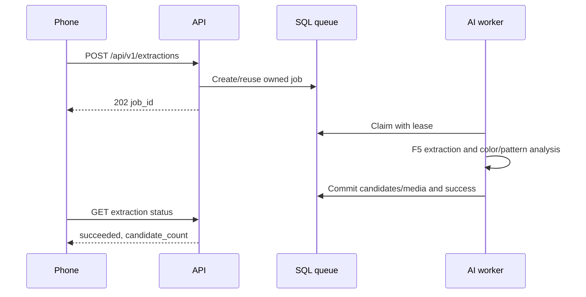

# OOTD-08 — Durable AI garment extraction

Version 1.0 · 20 October 2026 · Owner: AI/Backend · Status: proposed job service over existing F5 logic.

## 1. Overview and scope

Objective: turn an owned uploaded photo into reviewable garment candidates while surviving client disconnects and laptop service restarts. Persona: owner waiting for several models on laptop hardware. Pain: long synchronous requests, repeated processing and misleading progress.

Verified: `F5/segmenter.py` uses SegFormer, worn/flat-lay branches, optional BiRefNet and `analyze_garment`; output fields include category, label, path, color, colors, pattern, scale, pixels, nullable confidence and is_flatlay. No durable job API was found. Stage-image capture is available in root scripts, not a verified F5 API capability.

In scope: job lifecycle, bounded queue/worker, F5 adapter, result publication and actual stage reporting. Out: model retraining, on-phone inference, accuracy guarantees and automatic algorithm changes.

## 2. Requirements and acceptance

| Requirement | Acceptance criterion |
|---|---|
| FR1 Run the selected pipeline | Pin F5 source/model revisions and match baseline fixtures; documented mapping preserves category, colors, scale, area and nullable confidence. |
| FR2 Durable processing | Job states queued/running/succeeded/failed persist; disconnect does not cancel work; restart reclaims interrupted jobs at most once automatically. |
| FR3 Bounded work | One initial inference worker, max 2 active jobs/account and 10 queued globally; excessive requests get 429. |
| FR4 Truthful progress | UI displays queued/loading/segmenting/matting/analyzing/saving stages only when reached; no fabricated percentage or ETA. |
| FR5 Handle empty/degraded outcomes | No detected garments is successful empty output; unavailable matting yields explicit fallback metadata; segmentation failure is a failure, not empty success. |
| FR6 Publish consistently | Terminal success is set only after all candidate/media records are durable; retrying a creation request does not create another job for the same photo/pipeline revision. |

## 3. Flow

Upload ready → create job → queue → worker leases job → load cached models → process F5 stages → stage cutouts/optional diagnostics → persist candidates/result → terminal state → phone opens review.

## 4. Frontend

Use F5 spinner styling with human-readable stages. Poll every 2s while visible, back off to 10s after 30s; pause in background and resume by stored job UUID. Back returns home with an “In progress” card, not an inferred cancel. Limit network retries with jitter; do not create new jobs on each poll failure.

Show “Taking longer than usual” after 120s without claiming failure. Proposed worker runtime timeout 300s excluding queue; actual hardware benchmark may require revision. A failed job offers explicit Retry; fresh retry uses the retry endpoint and new operation ID. Invalid auth routes through serialized refresh.

## 5. Proposed API contracts

All routes HTTPS/bearer. POSTs JSON plus `Idempotency-Key`; GET no body. Ownership checked before state disclosure.

| API; example request | Success | Failure |
|---|---|---|
| `POST /api/v1/extractions` `{"photo_id":"40000000-0000-4000-8000-000000000001"}` | `202 {"job_id":"50000000-0000-4000-8000-000000000001","status":"queued","pipeline_version":"f5-baseline-v1"}` | `404 {"error":{"code":"PHOTO_NOT_FOUND","message":"Photo not found.","retryable":false},"request_id":"r-80"}` |
| `GET /api/v1/extractions/50000000-0000-4000-8000-000000000001` | `200 {"job_id":"50000000-0000-4000-8000-000000000001","status":"succeeded","stage":"complete","candidate_count":3,"mode":"worn","matting_status":"available","error":null}` | `404 {"error":{"code":"JOB_NOT_FOUND","message":"Extraction not found.","retryable":false},"request_id":"r-81"}` |
| `POST /api/v1/extractions/50000000-0000-4000-8000-000000000001/retry` `{}` | `202 {"job_id":"50000000-0000-4000-8000-000000000002","status":"queued","retry_of":"50000000-0000-4000-8000-000000000001"}` | `409 {"error":{"code":"JOB_NOT_RETRYABLE","message":"Only failed extractions can be retried.","retryable":false},"request_id":"r-82"}` |

Status fields vary safely: nonterminal `candidate_count:null`, `mode:null`, `matting_status:"pending"`; failed status has `error:{"code":"MODEL_UNAVAILABLE","retryable":true}`. Status GET stays 200 for an owned failed job. Other errors: 409 PHOTO_NOT_READY, 429 QUEUE_FULL, 503 WORKER_UNAVAILABLE, 401 auth; no raw exception text.

Workflow: transaction validates ready photo and owner, reserves unique active/completed job for `(owner,photo,pipeline_version)` and enqueues it. A retry is allowed only when previous terminal state is failed; link retry_of and prevent concurrent retry children. Worker claims with row lock/skip-locked and lease heartbeat. It uses an isolated process so a timeout can terminate inference safely; no duplicated competing workers after expired leases.

Normalize F5 output to candidates, copying generated media into private owner/job directories. Change storage plumbing without silently changing masking math. `pixels→area`, `scale→pattern_scale`, `path→media_id`; retain `upper/lower/footwear/bag/headwear/full`. Flat-lay's default `upper` must be marked `category_needs_review:true`, not portrayed as reliable automatic classification.

## 6. Database, security and operations

Proposed `extraction_jobs(job_id,user_id,photo_id,pipeline_version,status,stage,attempt,lease_until,started_at,finished_at,error_code,retry_of)`; `candidates(candidate_id uuid,job_id,user_id,media_id,metadata jsonb,saved_garment_id uuid null,expires_at)`; private media and outbox. Job media publication is staged; status/candidates/outbox commit atomically after files finalize.

Do not expose arbitrary model names/download URLs in mobile requests. Pin model revisions, audit BiRefNet remote code before packaging, cache weights locally. Avoid importing F5 modules in a working directory that writes source storage or triggers startup cleanup. No live photo/model calls in analytics.

Metrics: queue depth/age, stage runtime, fallback/no-garment rates, worker heartbeat, memory and disk; local operator alert after missed lease or repeated failures. Job-create/status p95 <500ms. Inference latency is unmeasured; record warm/cold p50/p95 before release. The root saved 35.3s artifact is not a target.

## 7. Analytics

Consented envelope includes event UUID/version/time, account UUID/distinct ID, app session correlation, platform/app version/screen/source. Server rechecks consent at outbox dispatch.

| Event | Trigger | Properties |
|---|---|---|
| `extraction_started` | Worker first enters running | `operation_id:uuid`, `pipeline_version:string`, `attempt:int` |
| `extraction_stage_completed` | Actual stage completes once | `stage:enum`, `duration_ms:int`, `operation_id:uuid` |
| `extraction_succeeded` | Result commits | `item_count:int`, `mode:enum`, `matting_status:enum`, `duration_ms:int` |
| `extraction_failed` | Terminal failure | `error_code:enum`, `retryable:bool` |
| `extraction_retried` | Accepted retry job | `attempt:int`, `operation_id:uuid` |
| `processing_screen_left` | Explicit navigation away | `job_state:enum`, `continues_in_background:bool=true` |

Example: `{"item_count":3,"mode":"worn","matting_status":"fallback","duration_ms":42000,"pipeline_version":"f5-baseline-v1"}`. No event on each polling tick. Unique event IDs per job attempt/stage; background navigation is not extraction abandonment. Review drop-off is inferred by absence of result view within 24h of success.

KPI: terminal successes / started attempts, no-garment share, fallback share, p95 queue/compute separately. Target zero duplicated terminal writes.

## 8. Tests

| ID | Preconditions/data | Steps | Expected | Priority/type |
|---|---|---|---|---|
| T01 | Fixed worn/flat-lay F5 fixtures and pinned models | Run adapter against baseline | Categories/cutouts/metadata match documented tolerance | P0 regression/AI |
| T02 | No garments image | Create and wait | Success with zero candidates, helpful review state | P0 functional |
| T03 | BiRefNet unavailable; SegFormer available | Process | Explicit fallback; no fabricated matte | P0 integration |
| T04 | Missing SegFormer/OOM/timeout | Process each | Terminal failure, safe retry | P0 negative |
| T05 | Other user's photo/job UUID | Create/poll/retry | 404, no ownership leak | P0 security |
| T06 | Duplicate POST and concurrent retry | Send same key; parallel retries | One job/retry child | P0 concurrency/API |
| T07 | Kill worker mid-run; restart | Reclaim lease | At most one automatic retry, no duplicate candidates | P0 recovery |
| T08 | Disconnect phone/background app | Resume polling | Same job result, no new inference | P0 lifecycle/UI |
| T09 | Fill queue and request status | Submit load | 429 on excess, status stays responsive | P1 performance |
| T10 | File/DB failure during result commit; repeated polls | Inject, recover; inspect outbox | No false success; one event per stage/outcome | P0 consistency/analytics |

FR1→T01; FR2→T07/08; FR3→T09; FR4→T08/10; FR5→T02–04; FR6→T05/06/10.

## 9. Implementation and dependencies

AI: freeze baseline and write adapter exposing stage callbacks without altering model logic. Backend: durable queue/lease/process isolation, private media publication, status/retry API. Mobile: polling/resume UI. SQL: 19 jobs/candidates. QA: golden fixtures, crash injection and target laptop benchmarks.

Dependencies: 07 photo readiness, 09 result contract, 18 events. Open: hardware capacity, model revision/licence availability, accepted numerical tolerance. Record source bugs and corrections separately; no claim of identical AI outputs before comparison.

## 10. Release readiness

- [ ] Pinned F5 baseline and adapter comparisons pass.
- [ ] Queue, crash, retry and publication tests pass.
- [ ] Empty/fallback/failure states visibly differ.
- [ ] Inference benchmark and timeout agreed for actual laptop.
- [ ] No false progress, public media or duplicated events.
