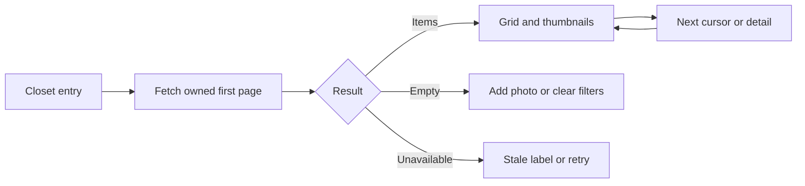

# OOTD-10 — Wardrobe browsing and filtering

Version 1.0 · 20 October 2026 · Owner: Mobile/Backend · Status: proposed.

## 1. Overview and scope

Objective: show only the signed-in owner's garments in a familiar F5 light closet, with reliable filtering, search and pagination. Personas: imported wardrobe owner and new user with no items. Pain: mixed accounts, slow image lists and confusing empty states.

Verified: F5 `GET /api/items` applies `user_id` and optional category; the frontend renders cutout cards and categories. Proposed additions: cursor pagination, explicit unauthenticated error, owner-scoped search and stale-cache UX. No wardrobe statistics dashboard, bulk editing or offline synchronization.

## 2. Requirements and acceptance

| Requirement | Acceptance criterion |
|---|---|
| FR1 Show owned records only | List and image requests use authenticated UUID ownership; another account's items never appear, including cache/back navigation. |
| FR2 Preserve categories | All, Topwear, Bottomwear, Shoes, Accessories and Other filters map to stored F5 values; Accessories includes bag and headwear. |
| FR3 Search and paginate | Search label/color-name/pattern with query ≤80 chars; debounce 300ms; pages default 30/max100, stable created_at/UUID ordering. |
| FR4 Distinguish states | First-use empty, no filter/search matches, offline stale content and service error have different copy/actions. |
| FR5 Refresh predictably | Saving/editing/deleting invalidates the relevant list; filter/scroll persists across detail navigation. |
| FR6 Render accessibly and efficiently | Lazy thumbnails, contained cutouts, semantic label/category/color, 48 dp actions and 200% text without clipped cards. |

## 3. Flow

Closet entry → validate session → fetch first page/filter → load authorized thumbnails → scroll for cursor → open garment detail. Pull-to-refresh resets cursor and preserves filter; changes in filter invalidate in-flight requests.



## 4. Frontend

F5 cream background/white cards/sage category pills. Respect PNG alpha and garment aspect ratio; never crop shoes to fill. Show imported missing-media placeholder without hiding item metadata. Search text stays on-device/server; it is never an analytics property.

Maintain immutable query state and generation IDs; late responses to an old filter cannot overwrite current content. Clear all list/thumbnail caches on account/server change. Offline cached content is read-only and only available to the same authenticated local account; expired login does not unlock it for a different user.

Target first page p95 ≤500ms API plus ≤1s visible thumbnails on test LAN; stable scroll at target phone refresh rate with decoded thumbnail bounds. No aggressive automatic retry while backgrounded.

## 5. Proposed API and backend

HTTPS/bearer GET, no body; query `category`, optional `q`, `sort=newest|oldest`, `limit`, opaque `cursor`.

```http
GET /api/v1/garments?category=accessories&limit=30&sort=newest
Authorization: Bearer <access_token>

200 OK
{"items":[{"garment_id":"70000000-0000-4000-8000-000000000010","version":1,"label":"Canvas bag","category":"bag","media_id":"80000000-0000-4000-8000-000000000010","color_hex":"#c2b280","color_name":"sand","pattern":"solid","wear_count":2,"created_at":"2026-10-20T10:00:00Z"}],"next_cursor":null,"counts":{"all":1,"upper":0,"lower":0,"footwear":0,"accessories":1,"full":0}}
```

Failure (`422`):

```json
{"error":{"code":"INVALID_FILTER","message":"Choose a supported wardrobe filter.","retryable":false},"request_id":"r-100"}
```

Other errors: 401 auth, 422 INVALID_CURSOR/QUERY_TOO_LONG, 429 READ_LIMIT, 503 DATABASE_UNAVAILABLE. An empty list is `200` with `items:[]`, null cursor and valid counts, never a substitute for unauthenticated access.

Consumed media API: `GET /api/v1/media/80000000-0000-4000-8000-000000000010`, bearer; success `200 image/png` bytes/private cache; failure `404 {"error":{"code":"MEDIA_NOT_FOUND","message":"Image unavailable.","retryable":false},"request_id":"r-101"}`. OOTD-09 owns its implementation.

Workflow: validate session/filters → construct parameterized owner/deleted_at-null query → apply query and category → decode owner/query-bound cursor → fetch limit+1 → return summary DTO. `counts` are owner-wide active category totals independent of search, explicitly labelled in UI. Reject wildcard/control abuse; escape SQL LIKE wildcards when search is literal. No file paths or password data in DTO.

## 6. Data, consistency and observability

Read `garments` and `media`; indexes `(user_id,deleted_at,created_at,garment_id)` and `(user_id,category)`. Optional search index only after measurement. Cursor binds sort/query/owner to prevent cross-user reuse. No DB migration beyond indexes and 19 schema.

Pagination is a stable keyset over current records, not a historical snapshot: new items may require refresh; dedupe returned UUIDs in client; deletes may shorten a page. API never creates items on GET.

Proposed 120 list calls/minute/account, 300 media/minute with bounded concurrency; cache metadata privately for ≤30s and invalidate after local mutations. Logs: latency, result count, filter enum; no raw `q`. Alert operator for sustained DB unavailability; metrics for missing thumbnail and slow query rates.

## 7. Analytics

Consented envelope: event UUID/version/time, distinct/user IDs, app session UUID, platform/app version/screen/source. No query text, labels or image URLs.

| Event | Trigger | Properties |
|---|---|---|
| `screen_viewed` | Closet visible | `screen_name:"wardrobe"`, `entry_point:string` |
| `wardrobe_loaded` | First page shown | `item_count:int`, `empty:bool`, `cached:bool`, `duration_ms:int` |
| `wardrobe_filter_applied` | Category/sort change | `filter:enum`, `sort:enum` |
| `wardrobe_search_used` | Search submitted after debounce | `query_length_bucket:enum`, `result_count:int` |
| `wardrobe_item_opened` | Card tap | `category:enum`, `position:int` |
| `wardrobe_load_failed` / `wardrobe_load_retried` | Error/retry | `error_code:enum`, `attempt:int` |

Example: `{"filter":"accessories","sort":"newest","item_count":12,"cached":false}` plus envelope. One load outcome per request generation; stale discarded requests are not views. Browsing exit is normal; infer no-item-open sessions rather than emitting a failure.

KPI: item-open sessions / nonempty closet sessions, empty-filter rate, load p95. Access-isolation failure target zero.

## 8. Tests

| ID | Preconditions/data | Steps | Expected | Priority/type |
|---|---|---|---|---|
| T01 | A/B with distinct garments | List as each | Only owned rows/counts | P0 security/API |
| T02 | bag/headwear/full fixtures | Apply each filter | Correct mapping/counts | P0 functional |
| T03 | 65 items with same timestamps | Page forward/refresh | Stable IDs, no duplicates | P0 pagination |
| T04 | Search special characters/81 chars | Search each | Safe literal search/422, no SQL injection | P0 negative/security |
| T05 | Rapid category/search changes | Delay older response | Current filter remains correct | P1 concurrency/UI |
| T06 | No data vs no matches vs server off | Open each state | Distinct copy and recovery | P0 UI/integration |
| T07 | Edit/save/delete from another feature | Return/pull refresh | Updated list without account leakage | P0 regression |
| T08 | Missing media/foreign media UUID | Load tiles | Placeholder or 404; grid remains usable | P0 media security |
| T09 | 1,000 rows, phone scroll/text 200% | Browse/measure | Limits/latency, no clipped controls | P1 performance/accessibility |
| T10 | Consent off/on and logout/account switch | Browse/search; inspect events/cache | No query/label leak or duplicate views | P0 analytics/privacy |

FR1→T01/08/10; FR2→T02; FR3→T03–05; FR4→T06; FR5→T07; FR6→T09.

## 9. Implementation and dependencies

Backend: owner/query-bound keyset list, summaries/counts, indexes. Mobile: cached query controller, light grid, empty/error states. QA: pagination and mutation refresh fixtures. Analytics: 18 schema.

Depends on 04, 09 media, 11 details, 19 imported/new garments. Open: device thumbnail memory budget; actual imported category anomalies go through migration quarantine rather than silent remapping.

## 10. Release readiness

- [ ] Ownership/count/search/pagination verified.
- [ ] F5 categories and missing-media states match requirements.
- [ ] Cache clear/refresh and stale-response handling pass.
- [ ] Performance and accessible card layout measured.
- [ ] Analytics excludes queries and private item data.
