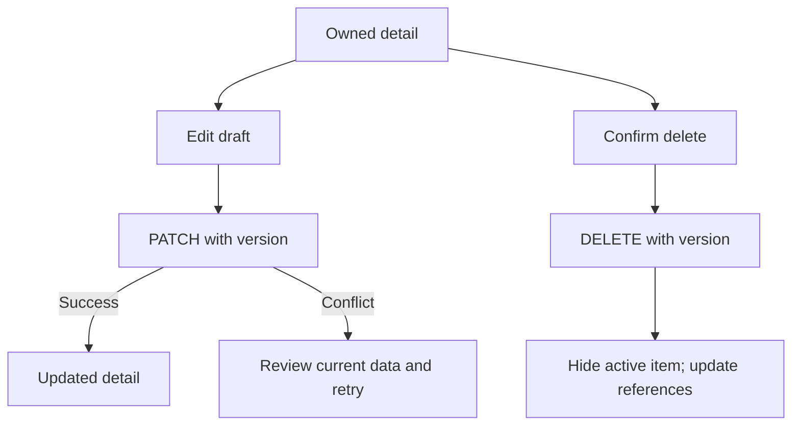

# OOTD-11 — Garment detail, editing and deletion

Version 1.0 · 20 October 2026 · Owner: Mobile/Backend · Status: proposed.

## 1. Overview and scope

Objective: inspect and correct a saved garment or remove it without corrupting outfits/history. Persona: owner correcting AI/imported metadata. Pain: stale updates, wrong colors used for scoring and broken references after deletion.

Verified F5 has item PUT(label/category/color) and owner-scoped DELETE; update success does not check affected row count. Proposed design adds explicit detail GET, version conflicts, consistent effective palette and recoverable file cleanup. No pixel editing, image replacement, bulk delete or undo UI.

## 2. Requirements and acceptance

| Requirement | Acceptance criterion |
|---|---|
| FR1 Read only owned item | Detail returns full allowlisted DTO or 404 for missing/foreign/deleted item. |
| FR2 Validate edits | Label 1–80 chars, supported category and `#RRGGBB`; confidence/AI source metadata cannot be client-forged. |
| FR3 Prevent lost updates | PATCH/DELETE require `If-Match`; stale version returns 409 with current_version; UI preserves draft for comparison. |
| FR4 Synchronize color semantics | Color edit changes effective palette/name, retains original analysis and invalidates recommendation caches. |
| FR5 Delete consistently | Confirmation names the garment; success hides it from active lists/scoring, flags affected saved outfits and preserves historical audit references. |
| FR6 Handle media/reference cleanup | No live shared media is deleted; failed cleanup is retried; private media access ends when no permitted live reference remains. |

## 3. Flow

Closet card → detail GET → edit draft → PATCH with version → reload detail/closet. Delete → confirmation → versioned DELETE → tombstone/reference updates transaction → close detail → background cleanup.



## 4. Frontend

F5 white garment card, contained cutout, label/category/color and analysis section. Human-readable confidence may be absent. Preserve imported unknown fields with “Unknown,” not invented values. Editing exposes only supported fields.

Save action disabled until valid and changed. Back with unsaved changes offers discard/continue. On 409 retain draft and show latest values; explicit retry uses new version and key. Delete disabled while pending. Network timeout queries detail or replays same operation to determine outcome, never announces success optimistically.

TalkBack labels, 48 dp controls, 200% text; destructive action distinct by text and confirmation, not color alone. Load ≤500ms and mutation ≤1s p95 proposed excluding media.

## 5. Proposed APIs

HTTPS/bearer; JSON PATCH, `If-Match` and `Idempotency-Key` on PATCH/DELETE. GET no body.

```http
GET /api/v1/garments/70000000-0000-4000-8000-000000000001

200 OK
{"garment_id":"70000000-0000-4000-8000-000000000001","version":1,"label":"Green tee","category":"upper","media_id":"80000000-0000-4000-8000-000000000002","color_hex":"#2c524a","color_name":"pine","colors":[{"hex":"#2c524a","name":"pine","share":1.0}],"pattern":"solid","pattern_scale":"none","area":74448,"confidence":0.982,"source":"extracted","wear_count":0,"last_worn_at":null,"created_at":"2026-10-20T10:00:00Z"}
```

GET failure: `404 {"error":{"code":"GARMENT_NOT_FOUND","message":"Garment not found.","retryable":false},"request_id":"r-110"}`.

| Mutation/request | Success | Failure |
|---|---|---|
| `PATCH /api/v1/garments/70000000-0000-4000-8000-000000000001`; `If-Match: "1"`; `{"label":"Everyday tee","color_hex":"#008080"}` | `200 {"garment_id":"70000000-0000-4000-8000-000000000001","version":2}`; detail reload uses full DTO | `409 {"error":{"code":"VERSION_CONFLICT","message":"This garment changed. Review the latest version.","retryable":false,"current_version":2},"request_id":"r-111"}` |
| `DELETE /api/v1/garments/70000000-0000-4000-8000-000000000001`; `If-Match: "2"`; no body | `200 {"deleted":true,"affected_saved_outfits":1}` | `404 {"error":{"code":"GARMENT_NOT_FOUND","message":"Garment not found.","retryable":false},"request_id":"r-112"}` |

Media consumption: `GET /api/v1/media/80000000-0000-4000-8000-000000000002` bearer → 200 PNG bytes/private cache, or 404 MEDIA_NOT_FOUND in the same error shape. Other mutation errors: 422 field validation, 428 VERSION_REQUIRED, 401 auth, 429 rate, 503 DB. Same-key successful delete replay returns original 200; a new request to deleted UUID returns 404.

Backend: validate owner and version under row lock; validate only allowlisted changes; compute normalized color/name/effective single-color palette if overridden; increment version; increment owner wardrobe revision for cache invalidation; commit audit/outbox. Delete soft-tombstones item, flags linked saved outfits incomplete and queues unreferenced media cleanup. Never trust client counts or paths. Stored wear history stays factual.

## 6. Data and operations

Read/write `garments`, owner wardrobe revision, saved-outfit links and cleanup outbox. Keep `analysis_original`, `version`, `deleted_at`; preserve user edits separate from machine estimates. Media cleanup is reference-counted or checked under locks; no filesystem deletion before transaction commit. Tombstones retained for history; they are excluded from active APIs.

SQL foreign keys include owner relation. Rate proposed 30 mutations/minute/account. Audit field names/version, not labels/content. Metrics: conflicts, deletes, cleanup backlog; alert operator on cleanup failures >24h. Private caches invalidated on edit/delete; no shared public caching.

## 7. Analytics

Consented envelope: event UUID/version/time, distinct/user ID, app session UUID, Android/app version/screen/source.

| Event | Trigger | Properties |
|---|---|---|
| `garment_detail_viewed` | Detail rendered | `category:enum`, `source:enum` |
| `garment_edit_submitted` | Save intent | `operation_id:uuid`, `changed_fields:string[]` allowlist |
| `garment_updated` | Server commit | `operation_id:uuid`, `changed_fields:string[]` |
| `garment_deleted` | Server tombstone commit | `operation_id:uuid`, `affected_saved_outfits:int` |
| `garment_change_failed` / `garment_change_retried` | Error/retry | `action:enum(edit,delete)`, `error_code:enum`, `attempt:int` |
| `garment_edit_abandoned` | Explicit draft discard | `changed_fields:string[]` |

Example: `{"action":"edit","changed_fields":["color_hex"],"attempt":1}`; no new/old values. Deduplicate server events per mutation; one retry does not add another update. KPI: committed edits / submitted operations within 10 minutes; conflict recovery and deletion completion rates.

## 8. Tests

| ID | Preconditions/data | Steps | Expected | Priority/type |
|---|---|---|---|---|
| T01 | Owned valid garment | Read/edit/reload | Valid new fields and version increment | P0 functional |
| T02 | Foreign/deleted UUID | GET/PATCH/DELETE | 404, no disclosure/mutation | P0 security/API |
| T03 | Invalid label/color/category; injected confidence | PATCH each | 422, unchanged DB | P0 negative |
| T04 | Two devices edit version1 | Submit conflicting edits | One success, one 409; draft retained | P0 concurrency |
| T05 | Change primary color | Score outfit afterward | Effective palette matches displayed color | P0 integration/regression |
| T06 | Garment in saved outfit/history | Confirm delete | Closet removed, favorite incomplete, history retained | P0 consistency |
| T07 | Shared media plus disk cleanup failure | Delete one item; retry worker | Live file remains; orphan retry safe | P0 recovery |
| T08 | Response lost/double delete | Replay same key | Original success, one tombstone/event | P0 idempotency |
| T09 | Edit then Back with large text/TalkBack | Navigate and discard | Accessible confirmation, no unintended save | P1 UI |
| T10 | Mutation burst; consent on/off | Measure/inspect | Throttling/targets; values absent from analytics | P1 performance/privacy |

FR1→T01/02; FR2→T03; FR3→T04/08; FR4→T05; FR5→T06; FR6→T07.

## 9. Implementation and dependencies

Mobile: detail/form/conflict comparison, confirmed delete. Backend: versioned mutations, color adapter, invalidation and cleanup. SQL: 19 schema; favorites dependency 15; wear history 16. Analytics: 18. QA: references and timeout races.

Open: tombstone retention policy for eventual account deletion (outside v1); missing imported media remains editable as metadata without claiming an image exists.

## 10. Release readiness

- [ ] Version/ownership/mutation tests pass.
- [ ] Display and scoring metadata agree.
- [ ] Saved outfits/history remain consistent after deletion.
- [ ] Cleanup can retry without touching live files.
- [ ] API/UI/analytics confirm the same committed outcome.
