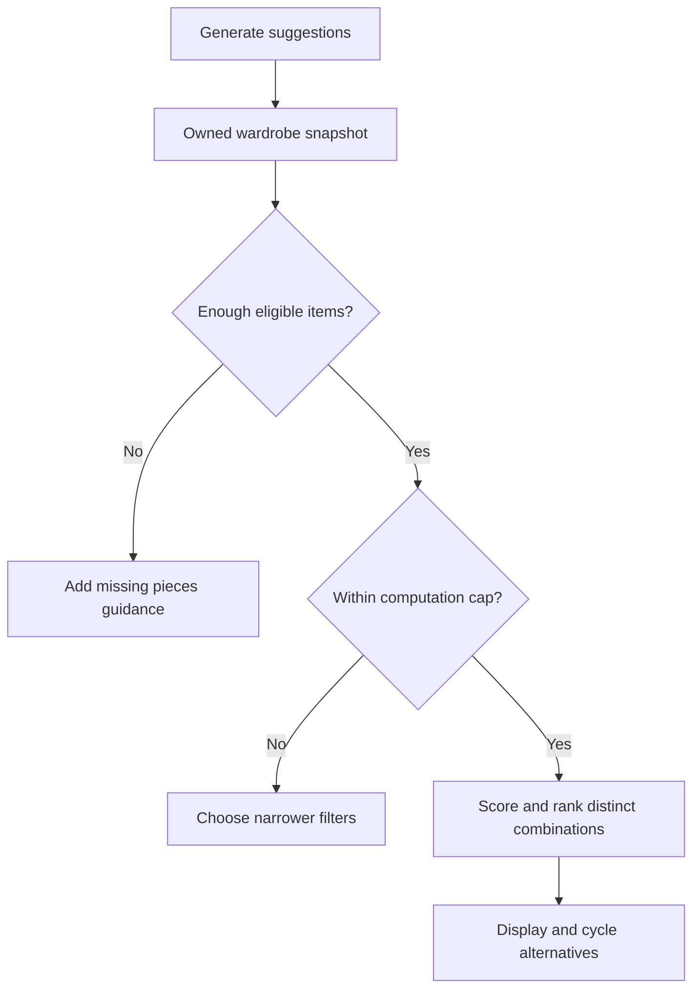

# OOTD-14 — Outfit recommendations

Version 1.0 · 20 October 2026 · Owner: AI/Backend/Mobile · Status: proposed Android feature.

## 1. Overview and scope

Objective: generate usable combinations from the owner's closet and let them browse alternatives in F5's recommendation layout. Persona: owner choosing an outfit quickly. Pain: empty unexplained suggestions, repeat results and combinatorial delays.

Verified F5 `/api/suggest` uses `rank_combinations`, returns best outfit and all_suggestions. The scorer supports upper+lower or full-body with optional shoes/accessories; it calculates wear-adjusted scores but sorts by raw score. A reroll that refetches unchanged inputs can repeat the same best result.

In scope: bounded generation, eligible combinations, ranking, next suggestion, versioned results and fallback guidance. Out: weather, personal body data, shopping links, taste learning and changing wear-based ranking silently.

## 2. Requirements and acceptance

| Requirement | Acceptance criterion |
|---|---|
| FR1 Owner-only generation | All candidates come from current user's active garments; no foreign item IDs or images in results. |
| FR2 Respect F5 combination logic | Upper+lower or full-body; optional footwear and at most one accessory; unscorable single-item combinations omitted. |
| FR3 Stable, explainable ranking | Use documented `f5-adapter-v1` raw score order with deterministic UUID tie-break; never claim wear rotation affects rank while it does not. |
| FR4 Useful alternatives | Next/re-roll cycles through returned distinct combinations before repeating; if only one exists, explain that instead of claiming a new outfit. |
| FR5 Bound resource use | Estimate combination count before materializing; proposed maximum 20,000 evaluated combinations/request; larger closets require user filters instead of silently sampling. |
| FR6 Handle empty/stale results | Missing category guidance shown; edited/deleted wardrobe invalidates snapshot; save/wear revalidate versions. |

## 3. Flow

Outfit Generator → request suggestions → snapshot owner wardrobe → eligibility/count check → enumerate and score → return top five (max ten) → render F5 score/palette/notes/cards → next → save/wear.



## 4. Frontend

Light F5 recommendation sheet/full screen: Color Harmony Score, verdict badge, palette, stylist notes, garment cards, Next outfit, Save and Wear. No thumbnails are fabricated when media is missing.

Loading disables Generate but keeps closet usable. API returns no suggestions as an ordinary 200 empty state with reason. Failures show retry. Snapshot is invalidated after garment mutations; old cards labelled stale. Next cycles locally, so repeated button taps do not rerun the server. Last-to-first wrap is labelled.

Use explicit “Color/pattern suggestions” copy; don't imply a learned personal stylist. Target generation response ≤2s p95 for ≤1,000 combinations; 10s computation ceiling for the bounded maximum, subject to actual laptop measurement. Busy service returns recoverable error, never hangs other APIs.

## 5. Proposed API and backend

`GET /api/v1/outfits/recommendations?limit=5`; HTTPS/bearer, no body. Optional filters `upper_id`, `lower_id`, `full_id`, `footwear_id`, `accessory_id` must all be owned and mutually compatible.

Illustrative success contract:

```json
{"wardrobe_revision":12,"algorithm_version":"f5-adapter-v1","evaluated_count":18,"suggestions":[{"recommendation_id":"b0000000-0000-4000-8000-000000000001","items":[{"garment_id":"70000000-0000-4000-8000-000000000002","version":1},{"garment_id":"70000000-0000-4000-8000-000000000001","version":1}],"score":72,"verdict":"solid","notes":["All-neutral palette. Safe, polished, and hard to get wrong.","Everything sits at a similar lightness, so the outfit reads flat. Swap one piece lighter or darker."],"palette":{"palette":[{"hex":"#111111","name":"black","share":1.0}],"dominant":{"hex":"#111111","name":"black","share":1.0},"accent":null,"neutral_share":1.0,"contrast":"low","temperature":"neutral","n_accent_colors":0}}],"empty_reason":null}
```

Numbers are illustrative DTO examples, not a recomputed score fixture. Empty `200`: `{"wardrobe_revision":1,"algorithm_version":"f5-adapter-v1","evaluated_count":0,"suggestions":[],"empty_reason":"NEED_TOP_AND_BOTTOM_OR_FULL_PLUS_ITEM"}`.

Failure (`422`):

```json
{"error":{"code":"WARDROBE_TOO_LARGE_TO_RANK","message":"Choose a top or another filter to narrow suggestions.","retryable":false},"request_id":"r-140"}
```

Other failures: 404 filtered item absent/foreign, 422 incompatible filters/limit, 401 auth, 429 RECOMMENDATION_LIMIT, 503 SCORING_BUSY, 504 SCORING_TIMEOUT.

Backend loads one consistent owner wardrobe snapshot and revision, adapts categories/colors/pattern_scale, computes Cartesian-product count without allocation, validates limit, iterates bounded combinations, runs the 13 pure scorer and keeps top K. Use stable ordering rather than random tie changes. Return no shared global recommendations. Generated recommendation UUIDs identify snapshots for analytics/UI, not authority for saving.

F5 includes shoes/accessory whenever available rather than always exploring “none”; preserve this combination behavior in the baseline. Any extension to optional skipping is versioned separately. No wear_count mutation on generation.

## 6. Data, caching, security and operations

Read `garments`, owner wardrobe revision and score configuration. Proposed cache `(user_id,revision,filters,algorithm_version)` TTL 60s; no durable saved outfit until 15. Cache payload excludes public media paths and uses owned item references.

Bound work in separate execution pool from HTTP loop; proposed 6 generation requests/minute/account, one concurrent/account. Metrics: eligible/evaluated combination counts, latency, cache hits, empty reasons, timeout. Local alert on repeated compute timeouts. Locks/snapshot prevent mixing versions within one result.

## 7. Analytics

Consented envelope: event UUID/version/time, distinct/user ID, app session UUID, Android/app version/screen/source.

| Event | Trigger | Properties |
|---|---|---|
| `recommendations_requested` | Generate pressed | `operation_id:uuid`, `filtered:bool`, `attempt:int` |
| `recommendations_viewed` | Results/empty state rendered | `result_count:int`, `empty_reason:nullable enum`, `duration_ms:int` |
| `recommendation_opened` | Current suggestion displayed | `rank:int`, `verdict:enum`, `cycled:bool` |
| `recommendation_refreshed` | User requests a new snapshot | `reason:enum(user,wardrobe_changed)` |
| `recommendations_failed` / `recommendations_retried` | Error/retry | `error_code:enum`, `attempt:int` |

Example: `{"result_count":5,"rank":2,"verdict":"strong","cycled":true}`. No item IDs/colors/photos. Dedupe views by snapshot/rank visit; empty is not failure. No save/wear within 24h of a nonempty result is inferred no-action, not a server failure.

KPI: suggestion-to-save and suggestion-to-wear conversion within 24h; empty reason share; p95 generation. Baseline success threshold set after measurement; correctness/isolation are release gates.

## 8. Tests

| ID | Preconditions/data | Steps | Expected | Priority/type |
|---|---|---|---|---|
| T01 | Upper/lower/shoes/bag fixture | Generate | Eligible combinations, owner-only | P0 functional |
| T02 | Full only; full+shoes; empty closet | Generate each | Honest empty or scored result | P0 edge/API |
| T03 | Foreign filter UUID | Request | 404, no exposure | P0 security |
| T04 | Fixture with tie/raw vs adjusted scores | Compare ranking | Raw-score parity and stable tie order | P0 regression |
| T05 | 5 suggestions / only1 | Tap Next repeatedly | Cycle distinct first; one-result notice | P1 UI |
| T06 | Edit/delete while generation pending | Return then save/wear | Snapshot stale/revalidation conflict | P0 concurrency |
| T07 | >20k combinations | Generate without filters then narrow | 422 guidance then bounded success | P0 performance/negative |
| T08 | Slow scoring/worker busy/network loss | Retry | 503/504 safe recovery, no duplicate writes | P1 integration |
| T09 | A/B identical metadata | Generate/cache both | Owner-separated IDs/results | P0 cache security |
| T10 | Consent, large text/TalkBack | View/cycle/retry | Accessible results, deduped events | P1 analytics/UI |

FR1→T01/03/09; FR2→T01/02; FR3→T04; FR4→T05; FR5→T07/08; FR6→T06.

## 9. Tasks and decisions

Backend: bounded iterator, count precheck, snapshot cache, stable rank and filters. Mobile: generator, empty guidance, local cycling. QA: source scorer comparisons and workload benchmark. Analytics: 18. Dependencies: 10 wardrobe, 13 scorer, 15/16 downstream mutations.

Open: measured safe cap on laptop; whether future wear-rotation ranking should replace raw-score parity. Record a separate version if chosen. Recommendation performance is not established by the existing prototype.

## 10. Release readiness

- [ ] Combination/ranking parity fixtures and owner tests pass.
- [ ] Cap/timeouts keep HTTP service responsive.
- [ ] Cycling and empty/stale states tested.
- [ ] Save/wear verify current versions.
- [ ] Conversion funnels use consented, deduped denominators.
