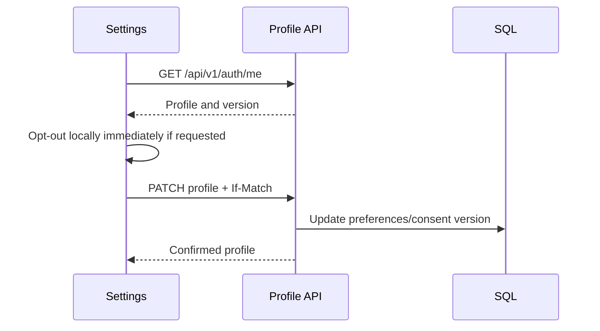

# OOTD-17 — Profile preferences

Version 1.0 · 20 October 2026 · Owner: Mobile/Auth · Status: proposed.

## 1. Overview and scope

Objective: show account identity, edit display name/timezone, control optional analytics and reach connection/logout actions. Persona: owner managing a shared laptop account from their own phone. Pain: confusion over active identity and hidden analytics settings.

Verified F5 exposes username/auth state but no profile edit route; another `wardrobe` prototype edits display_name, not selected for import. All profile changes below are proposed.

In scope: display name, timezone, analytics consent and settings entry links. Username renaming, password/email changes, account deletion, recovery and iOS are out of v1; no dead controls should advertise them. Logout is owned by 04 and pairing by 02.

## 2. Requirements and acceptance

| Requirement | Acceptance criterion |
|---|---|
| FR1 Show active identity | Settings shows correct username/display name and paired laptop status; private user UUID may be copied for support but is not editable. |
| FR2 Edit validated profile | Display name 1–60 chars and valid IANA timezone; server normalizes whitespace for name, not passwords; username/UUID immutable. |
| FR3 Prevent stale saves | PATCH requires version; conflicts preserve local draft and offer latest data. |
| FR4 Control analytics | Default off; turning off stops local capture/clears queued client events immediately; account-wide server setting is confirmed separately after sync. |
| FR5 Explain data flow | Copy states photos process/store on laptop and consented analytics may go to PostHog; no “all data stays local” claim when Cloud analytics enabled. |
| FR6 Navigate safely | Connection settings and logout use existing controllers; switching identity clears profile/private caches. |

## 3. Flow

Settings → read profile via me → edit fields/consent → PATCH → transaction/version → display confirmed values. Offline consent-off stops local capture immediately, shows pending server update, and retries when connected using a stored version/key.

## 4. Frontend

F5 light cards and labelled fields. Read-only username, editable name/timezone, Analytics toggle with description, Laptop connection, Logout, app version. Do not request email/phone merely for analytics.

Loading/saved/error/conflict/offline-pending states visible. Disable Save on invalid/no changes; one mutation pending. On conflict re-read and ask to reapply profile draft; for explicit opt-out, retain local off state until confirmed, never turn capture back on because of stale server response. Account consent-on requires confirmed server response before server events are enabled.

Support TalkBack switch state, 48 dp controls and 200% text. No server URL/identity in analytics. Local settings render <100ms from cache with pending verification; profile API target ≤500ms p95.

## 5. Proposed APIs and workflow

HTTPS/bearer; GET no body. PATCH JSON + `If-Match` + `Idempotency-Key`.

| API/request | Success | Failure |
|---|---|---|
| `GET /api/v1/auth/me` | `200 {"user_id":"20000000-0000-4000-8000-000000000001","username":"alex","display_name":"Alex","version":1,"analytics_consent":false,"consent_version":1,"timezone":"Asia/Kolkata"}` | `401 {"error":{"code":"SESSION_EXPIRED","message":"Please sign in again.","retryable":false},"request_id":"r-170"}` |
| `PATCH /api/v1/profile`; `If-Match:"1"`; `{"display_name":"Alex K","timezone":"Asia/Kolkata","analytics_consent":false}` | `200 {"user_id":"20000000-0000-4000-8000-000000000001","username":"alex","display_name":"Alex K","version":2,"analytics_consent":false,"consent_version":1,"timezone":"Asia/Kolkata"}` | `409 {"error":{"code":"VERSION_CONFLICT","message":"Profile changed on another device.","retryable":false,"current_version":2},"request_id":"r-171"}` |

`consent_version` increments only when consent value changes; profile `version` increments per successful change. GET is the same contract as 04. `timezone` is a required response key with string-or-null type; null means no user timezone selected yet. This is independent of the source timestamp interpretation used by migration.

Other errors: 422 INVALID_DISPLAY_NAME/INVALID_TIMEZONE/IMMUTABLE_FIELD, 428 missing version, 429 PROFILE_LIMIT, 503 DB. The server derives user ID from session, rejects any other owner field, validates timezone via its runtime timezone database and updates under version lock. Consent-off marks pending server analytics for suppression; workers recheck consent version at dispatch.

Logout consumed contract: `POST /api/v1/auth/logout` bearer or refresh revocation body → 200 `{"logged_out":true}`, or 503 REVOCATION_UNAVAILABLE structured as above; local logout still clears UI immediately. OOTD-04 owns session behavior.

## 6. Data, consistency and observability

`users` gains/uses display_name, timezone, analytics_consent, consent_version, version; consent audit is local operational storage, not a PostHog event emitted after opt-out. Migration defaults imported analytics consent false and timezone unresolved until source assumption is recorded.

Recheck current consent before outbox delivery. Offline opt-out cannot immediately change an unreachable server; explicitly show that account-wide change is pending. Do not claim previously delivered analytics are deleted by opt-out; deletion/export is outside this feature.

Proposed 10 profile mutations/minute/account. Audit changed field names/version/time only; no display name values. Metrics: conflicts, consent-sync failures and profile latency. Alert locally if sync repeatedly fails after connectivity returns; no remote analytics generated to report an opt-out itself.

## 7. Analytics

Consented envelope: UUID event/version/time, distinct/user ID, app session UUID, platform/app version/screen/source.

| Event | Trigger | Properties |
|---|---|---|
| `screen_viewed` | Profile visible while consent on | `screen_name:"profile"` |
| `profile_update_submitted` | Valid non-secret edit | `operation_id:uuid`, `changed_fields:string[]` |
| `profile_updated` | Server commit while consent remains on | `operation_id:uuid`, `changed_fields:string[]` |
| `profile_update_failed` / `profile_update_retried` | Error/retry with consent on | `error_code:enum`, `attempt:int` |
| `profile_edit_abandoned` | Explicit draft discard with consent on | `changed_fields:string[]` |

Example: `{"changed_fields":["display_name"],"attempt":1}`; no values/timezone/IP. Consent-off is never an excuse to send a final opt-out event. Operational local consent audit remains available for correctness. KPI: confirmed profile saves / submitted consented operations within 10 minutes; zero analytics after local opt-out except already in-flight requests.

## 8. Tests

| ID | Preconditions/data | Steps | Expected | Priority/type |
|---|---|---|---|---|
| T01 | Signed-in owner | Read/edit name/timezone | Correct profile/version | P0 functional |
| T02 | Invalid name/timezone/UUID edit | PATCH | 422, no mutation | P0 negative/API |
| T03 | A tries profile payload user B | Submit | Rejected; cannot alter B | P0 security |
| T04 | Two devices edit version1 | Submit both | Conflict, no lost edit | P0 concurrency |
| T05 | Consent on; toggle off | Inspect local queue/network and server outbox | Capture stops, queue cleared, dispatch suppressed after sync | P0 privacy |
| T06 | Server offline; toggle off; reconnect | Resume | Local off immediately; clear pending status then confirmation | P0 recovery |
| T07 | Late old consent-on response | Deliver after local off | Never re-enables capture | P0 race/regression |
| T08 | Logout/account switch | Return Settings/back | No former user profile/cache | P0 integration |
| T09 | Large text/TalkBack/toggle keyboard focus | Navigate | Labelled states and reachable actions | P1 UI |
| T10 | Burst/timeout/replay key | Measure and inspect events | Rate/latency, one update, no values leaked | P1 performance/analytics |

FR1→T01/08; FR2→T02/03; FR3→T04; FR4→T05–07; FR5→copy review/T05; FR6→T08/09.

## 9. Tasks and dependencies

Mobile: profile/version controller, consent gate/pending sync, connection/logout links. Backend: versioned profile mutation, consent audit/outbox suppression. SQL:19 fields. Analytics:18 SDK gate, 04 identity reset. QA: offline consent and stale response races.

Open: app-wide analytics host/region; account-wide consent vs per-device exceptions is resolved here as account-wide with immediate local off. All devices should refresh consent at authenticated resume and before capturing after a stale policy interval.

## 10. Release readiness

- [ ] Profile fields and version contract consistent with auth/me.
- [ ] Opt-out/offline/late-response tests pass.
- [ ] No personal values or opt-out event leakage.
- [ ] Paired server/logout routes work.
- [ ] Privacy wording accurately separates laptop photos and PostHog analytics.
