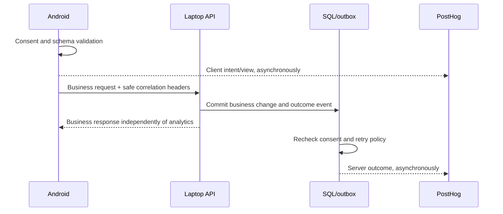

# OOTD-18 — PostHog analytics, feature diagnostics and funnels

Version 1.0 · 20 October 2026 · Owner: Product Analytics/Backend/Mobile · Status: proposed; no analytics installed or transmitted for this documentation task.

## 1. Overview, evidence and scope

Objective: show which screens people reach, which actions complete, and where they leave or encounter failures, with consistent identities and trustworthy counts. Personas: product owner reviewing adoption and engineer diagnosing broken steps. Pain: page views without outcomes, duplicate retry events, mixed accounts and private data leakage.

The user explicitly requested PostHog and `npx -y @posthog/wizard@latest`. Official [wizard documentation](https://posthog.com/docs/ai-engineering/ai-wizard) currently lists Flutter and FastAPI support. The command can modify source and configure analytics; it is deferred until application implementation because the user required PRDs first. Its output must be reviewed against this event specification. Support in docs does not prove integration in this local project.

The [Flutter SDK documentation](https://posthog.com/docs/libraries/flutter) supports explicit event capture, identifying users, opt-out and offline queuing. The proposed integration uses those capabilities with a strict allowlist. In scope: event schema, consent, identities, client/server correlation, dashboards/funnels and safe error summaries. Out: session replay, photo inspection, raw input recording, marketing attribution and self-hosting a PostHog stack on the laptop.

## 2. Functional requirements and acceptance

| Requirement | Acceptance criterion |
|---|---|
| FR1 Trace screen and action journeys | Each defined screen emits one canonical view per visit; feature intent/success/failure/retry events have documented producers. |
| FR2 Consistent identities | Anonymous consented events use a random install identifier; successful login identifies with SQL user UUID; logout resets anonymous identity and never reattributes queued A events to B. |
| FR3 Respect consent and data minimization | No optional capture before consent; opt-out stops local capture/clears queues; no passwords/tokens/photos/URLs/emails/usernames/labels/search text/IP properties/session replay. |
| FR4 Count outcomes once | Client intent and server durable outcome are separate; event UUID retained across retries; funnels can correlate one operation/flow without mixing simultaneous uploads. |
| FR5 Never block product work | Analytics offline/invalid key/provider failure cannot fail login/upload/save; bounded queues and retry/backoff are observable locally. |
| FR6 Explain drop-off correctly | Explicit cancellations differ from errors; inferred abandonment waits for the defined conversion window and excludes incomplete observation periods. |
| FR7 Ship usable dashboards | Activation, extraction-to-save, recommendation-to-save/wear, feature errors and screen usage dashboards validated against a synthetic fixture with known counts. |

## 3. Flow and responsibilities

Client consent gate → allowlisted event → local queue → PostHog Flutter SDK. Business request carries optional correlation metadata to API; transaction writes business data+outbox → dispatcher checks consent → PostHog server SDK. Neither analytics stream determines authorization or user-visible success.



## 4. Frontend integration and complete event schema

Implement one analytics adapter and typed event constants, not direct SDK calls in every widget. `screen_viewed` uses stable route names: welcome, server_connection, signup, login, home, photo_preview, processing, extraction_results, wardrobe, garment_detail, manual_item, outfit_builder, recommendations, saved_outfits, saved_outfit_detail, wear_history and profile. No route UUIDs/query strings in names.

| Property | Type/requirement | Example/rule |
|---|---|---|
| event | allowlisted string | `upload_started` |
| event_id | UUID, required | Generated once; mapped to SDK/provider dedupe field only after verifying version support |
| event_version | integer required | `1` |
| occurred_at | UTC RFC3339 required | `2026-10-20T10:00:00Z`; preserve original time while offline |
| distinct_id | string required | Random consented anonymous UUID or authenticated SQL UUID; pseudonymous, not anonymous after login |
| user_id | UUID or null | Same authenticated account UUID; null before login |
| session_id | UUID required | App analytics session; restart after 30 minutes inactivity; never auth token/session identifier |
| platform | enum | `android` |
| app_version | bounded string | `0.1.0+1` |
| screen_name | enum | `photo_preview` |
| source | enum | `client` or `server` |
| operation_id | UUID for actions | Stable logical action across retries |
| flow_id | UUID for multi-step journey | One photo→extraction→save journey; optional elsewhere |
| attempt | integer ≥1 when retryable | New network attempt count |
| consent_version | integer | Version captured for suppression checks |
| duration_ms | nonnegative integer optional | Monotonic elapsed duration; do not subtract unsynchronized phone/server clocks |
| error_code | allowlisted enum optional | `SERVER_UNREACHABLE`, never raw exception text |

Complete illustrative logical event (adapter input, **not a claimed PostHog HTTP wire schema**):

```json
{"event":"upload_started","event_id":"d0000000-0000-4000-8000-000000000001","event_version":1,"occurred_at":"2026-10-20T10:00:00Z","distinct_id":"20000000-0000-4000-8000-000000000001","user_id":"20000000-0000-4000-8000-000000000001","session_id":"d0000000-0000-4000-8000-000000000002","platform":"android","app_version":"0.1.0+1","screen_name":"photo_preview","source":"client","operation_id":"90000000-0000-4000-8000-000000000007","flow_id":"d0000000-0000-4000-8000-000000000003","attempt":1,"consent_version":2,"properties":{"source":"gallery","size_bucket":"under_1mb"}}
```

Adapter must distinguish envelope `source=client/server` from feature `source=gallery/camera/manual/extracted`: serialize the latter as `input_source` or `garment_source`. This avoids overwriting event provenance. Unknown properties are rejected/dropped and reported locally, never guessed.

Opt-out defaults apply before SDK initialization to prevent automatic lifecycle capture. Disable autocapture/session replay and automatic person properties unless each is explicitly allowlisted. No unredacted network URL/error-stack capture. Release debug logging off. Gallery/camera preview content must never enter replay.

## 5. Backend logic and integration contracts

No new public application analytics-ingestion API is required. Flutter and server SDKs handle provider transport; do not fabricate an existing PostHog REST endpoint, response code or dashboard ID.

Proposed internal interface `Analytics.capture(logical_event)` returns one of:

```json
{"status":"queued","event_id":"d0000000-0000-4000-8000-000000000001"}
```

Failure/disabled examples:

```json
{"status":"dropped","reason":"PROPERTY_NOT_ALLOWLISTED","retryable":false}
```

```json
{"status":"disabled","reason":"CONSENT_OFF","retryable":false}
```

These are application adapter statuses, not provider acknowledgements. “Queued” does not mean visible in PostHog. Delivery validation must use a test project/live-event inspection.

Business APIs accept optional validated `X-Analytics-Session-ID`, `X-Analytics-Operation-ID`, `X-Analytics-Flow-ID`, `X-App-Version` and `X-Consent-Version`; IDs must be UUIDs, version string max32. Reject/drop malformed analytics metadata without rejecting otherwise valid business work. Server derives account UUID and current consent itself, never from client event headers.

For unauthenticated signup/login, anonymous correlation is optional and has no authorization meaning. Server emits no outcome if no permitted consent can be established. After successful login, client identify links its consented anonymous history to the authenticated UUID; a failed username attempt never triggers identify. Historic imported rows do not generate fake historical signup/upload/save events.

Transaction outbox workflow: write event UUID and sanitized properties with business transaction; dispatch only committed rows; recheck account consent/version before every retry; preserve identity/time/event ID; record attempt/next_try; suppress after opt-out; never hold business locks while contacting PostHog.

Client queue proposed cap 500 events/24h; server outbox cap 10,000 pending events with 7-day TTL. Retry transient transport errors exponentially with jitter (initial5s, max5min); no retry for schema validation failure. At-least-once transport is expected. If the selected SDK lacks provider-side dedupe support, dashboards must explicitly count distinct `event_id`/operation IDs; do not promise exactly-once ingestion.

## 6. Event ownership and canonical naming

Detailed triggers/properties/tests remain in each standalone feature PRD. This table prevents incompatible double instrumentation.

| Area | Client intent/view | Server durable outcome | Client terminal error/retry |
|---|---|---|---|
| Navigation | `screen_viewed`, `home_action_tapped` | none | `navigation_failed`, `navigation_retried` |
| Pairing | `server_connection_started`, `server_connection_succeeded` | none | `server_connection_failed`, `server_connection_retried` |
| Signup/login | `signup_submitted`, `login_submitted` | `signup_succeeded`, `login_succeeded` with consent | `signup_failed/retried`, `login_failed/retried` |
| Selection | `photo_selected`, picker/camera events | none | selection/camera failure/retry/cancel |
| Upload | `upload_started` | `upload_succeeded` | `upload_failed/retried/cancelled` |
| Extraction | `processing_screen_left`, result view | `extraction_started`, stage-completed, succeeded/failed/retried | Poll errors are `api_request_failed`, not a second extraction outcome |
| Review/manual save | save/manual intent | `garment_saved` with garment_source | review/manual failure/retry |
| Garment mutations | edit/delete intent | `garment_updated`, `garment_deleted` | `garment_change_failed/retried` |
| Scoring/recommendations | requested/received/viewed/opened | none; read-only operation | scoring/recommendation failure/retry |
| Favorites | `outfit_save_tapped`, detail opened | `outfit_saved`, `outfit_unsaved` | `outfit_save_failed/retried` |
| Wear | `wear_outfit_tapped` | `outfit_worn_recorded`, `wear_record_undone` | `wear_record_failed/retried` |
| Profile | submitted/viewed | `profile_updated` only if consent remains on | profile failure/retry |
| Logout | `logout_tapped` | `logout_succeeded` if still permitted | revocation failures operationally logged |

Slash notation in this summary expands to full event names; never send a literal slash event name. Earlier page-specific names such as login_viewed/wardrobe_viewed map to canonical screen_viewed, not two separate view events.

Global `api_request_failed` properties: route template enum (no IDs/query), feature enum, HTTP status integer/null, safe error code, operation ID. `server_unreachable` is emitted once per connectivity transition, not every failed poll. `unexpected_error` is sanitized; `app_crashed` is used only for a verified crash signal from a tested integration, not inferred from an abandoned session.

## 7. Funnels, KPIs and dashboard acceptance

[PostHog funnels](https://posthog.com/docs/product-analytics/funnels) support conversion windows and repeat-event selection. Configure these explicitly; do not leave defaults that change the intended metric.

| Dashboard/funnel | Ordered steps | Window and counting rule |
|---|---|---|
| New-user activation | signup_succeeded → login_succeeded → garment_saved | 24h, unique identified user; exclude imported accounts and consent gaps |
| Upload reliability | upload_started → upload_succeeded | 10min, distinct operation_id; show cancel/error/unresolved separately |
| Extraction to closet | upload_succeeded → extraction_started → extraction_succeeded with item_count>0 → extraction_results_viewed → garment_saved | 24h, same flow_id and owner; count one converted flow even if three garments saved |
| Outfit adoption | recommendations_viewed with result_count>0 → recommendation_opened → outfit_saved OR outfit_worn_recorded | Two separate destination funnels, 24h per user/session; never claim unrelated save belongs to a suggestion without origin/flow correlation |
| Screen usage | screen_viewed by screen_name → feature intent | Session ≤30min inactivity, unique visits/users, not render count |
| Failure diagnostics | failed events by feature/error_code/app_version | Rate denominator is that feature's submitted operations; show sample size |
| Retention | garment_saved or outfit_worn_recorded activity | Seven-day return by consented user cohort; define calendar vs rolling window in dashboard |

Explicit exits/cancellations come from feature events. Inferred abandonment means no next qualifying event within completed window; latest incomplete windows excluded from rate trends. Network failure, unsupported photo, zero garments and user cancellation are separate reasons. Offline delivery uses occurrence time and can arrive late; dashboards may be provisional until queue TTL expires.

Release fixture: 10 upload operations, 2 explicit cancels, 1 terminal failure, 7 ready uploads; 1 ready upload produces zero garments; 6 nonempty results viewed; 4 flows save 9 total garments. Expected upload conversion 7/10, nonempty review-to-save 4/6 and saved-flow count4 (not9). Replay each event twice and results must remain unchanged under chosen dedupe query.

## 8. Data, security, performance and observability

Proposed `analytics_outbox(event_id uuid PK,user_id uuid nullable,consent_version int,event_name text,event_version int,occurred_at timestamptz,properties jsonb,status text,attempts int,next_try_at timestamptz,expires_at timestamptz)`. This is separate from auth audit and wardrobe SQL truth.

Only project ingestion configuration belongs in the app. Personal/admin API keys stay in private operator configuration and are unnecessary for client capture. Choose PostHog project/region before enabling. Cloud delivery necessarily uses external network; the core app continues offline from PostHog.

Target capture enqueue ≤5ms on UI thread; SDK networking asynchronous; analytics ≤1% added p95 API latency and zero dependency on provider availability. Monitor queue depth, dropped events by reason, dispatch failures and last successful send locally. No recursive “analytics failed” analytics events. Operational alert after 15 minutes sustained dispatch failure; product remains usable.

## 9. Test plan

| ID | Preconditions/data | Steps | Expected | Priority/type |
|---|---|---|---|---|
| T01 | Fresh install consent off | Navigate/login/upload | Zero optional external capture | P0 privacy |
| T02 | Consent on anonymous → login A → logout → B | Inspect identity and queued events | Correct linking/reset; no A→B reassignment | P0 identity/security |
| T03 | Duplicate renders/network retries | Trigger same logical outcome | One event ID/outcome; dashboards dedupe | P0 regression |
| T04 | 10-operation fixture above | Ingest then replay duplicates | Exact documented funnel counts | P0 analytics integration |
| T05 | Inject password/path/label/photo properties | Capture | Adapter drops/rejects; no provider leak | P0 negative/security |
| T06 | Provider offline/429/invalid config | Run all core workflows | Core succeeds; queue cap/backoff/TTL | P0 resilience |
| T07 | Consent off while queue pending | Toggle; dispatch/reconnect | Queue suppressed; no new capture | P0 concurrency |
| T08 | Two simultaneous upload flows | Interleave outcomes | No cross-flow funnel conversion | P0 analytics |
| T09 | Delayed delivery/timezone/clock skew | Queue/replay with original times | Stable occurrence times; no negative duration | P1 edge |
| T10 | Large event rate/UI scroll | Benchmark enqueue/API | Performance target and bounded memory | P1 performance |
| T11 | Browser/page aliases and native screens | Navigate route matrix | One canonical view per visit | P1 UI |
| T12 | Unexpected API error/native crash fixture | Inspect summaries | Sanitized error; crash only when verified | P1 diagnostics |

FR1→T03/11; FR2→T02; FR3→T01/05/07; FR4→T03/04/08; FR5→T06/10; FR6→T09/12; FR7→T04.

## 10. Implementation, decisions and release readiness

Mobile: analytics adapter/schema constants, consent-first SDK init, identity transitions, route observer and queue limits. Backend: correlation metadata, transactional outbox, consent recheck, dispatch. Analytics: test project, documented query definitions, five+ dashboards, dedupe verification. QA: fixture counts/privacy inspection.

Dependencies: all feature producers, 04 identity, 17 consent, 19 outbox SQL. Open: PostHog project/region, retention, actual SDK versions/dedupe field support and provider quotas. None has been configured or purchased.

- [ ] FR1–FR7 and T01–T12 pass in test project.
- [ ] Every event has one owner, schema and production trigger.
- [ ] Identity/consent tests include offline queues and account switches.
- [ ] Funnel fixtures match exact counts after duplicate delivery.
- [ ] No photos/replay/secrets; wizard modifications reviewed.
- [ ] SDK/cloud outages have no user-facing functional impact.
