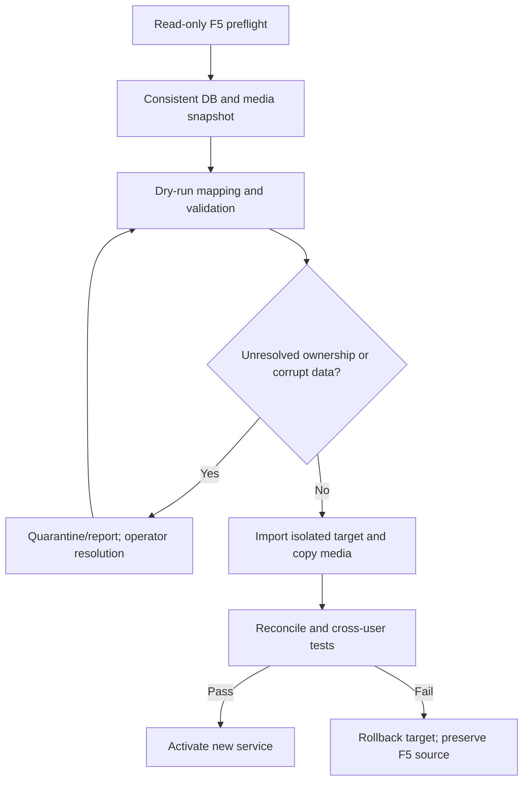

# OOTD-19 — SQL identities and F5 data migration

Version 1.0 · 20 October 2026 · Owner: Backend/Data · Status: proposed migration; no database opened or migrated during PRD preparation.

## 1. Overview, verified facts and scope

Objective: import F5 accounts, garments and wear history into a proposed PostgreSQL database on the laptop while preserving owner identity, files, login compatibility and recoverability.

Confirmed user decision: **F5 only**. Initial “more than one prototype” answer was superseded by the final “f5” clarification. No `wardrobe`, `f6` or other prototype data may be merged automatically.

Verified from `F5/db.py`: SQLite `users`, `items`, `outfits`; integer IDs; case-insensitive usernames; salted PBKDF2-SHA256 with 100,000 iterations; token per user; items/outfits may have `user_id DEFAULT 1`; demo user creation. `F5/main.py` starts cleanup on import/startup and exposes static storage. Actual DB schema/content/ownership has **not** been inspected. Files can predate current source.

Personas: laptop operator conducting migration and existing wardrobe owner retaining data. Pain: lost ownership, duplicated IDs, unsafe default-user mappings and missing images. In scope: schema/migrations, preflight, snapshot, dry run, deterministic ID mapping, copy, validation, activation and rollback. Out: live multi-source synchronization, account merging, data cleansing by guesswork and deleting the old prototype.

## 2. Requirements and acceptance

| Requirement | Acceptance criterion |
|---|---|
| FR1 Establish unique identities | Every user, photo, media, job, candidate, garment, favorite, wear event and auth session has a permanent UUID; foreign keys preserve ownership. |
| FR2 Preserve source correspondence | Unique `(source_instance_id,entity_type,legacy_id)` maps to exactly one target UUID; rerun against same snapshot adds zero duplicates. |
| FR3 Protect ownership | No record assigned to user1/demo/newest user by default; unresolved owners quarantined with explicit report and operator decision. |
| FR4 Preserve usable accounts | Import hash/salt/algorithm metadata only; legacy verification succeeds for valid users; tokens are discarded; demo/default accounts disabled until ownership/credential handling resolved. |
| FR5 Preserve garments/media/history | Valid metadata and referenced files copied/hashed; original timestamps/categories retained with provenance; F5 outfits become wear history, not favorites. |
| FR6 Dry-run and reconcile | Preflight/dry run creates no production rows; report covers source/imported/quarantined/missing counts and per-user totals; every discrepancy explained. |
| FR7 Recover safely | Consistent source backup and target rollback snapshot verified; failed import never activates partial data; original F5 data/files remain untouched. |
| FR8 Ship repeatable schema | Versioned SQL migrations tested on empty and imported DB; no SQLite-only PRAGMA executes against PostgreSQL. |

## 3. Operator flow

1. Identify exact F5 DB and referenced media roots from source/config without executing F5 app modules.
2. Inspect schema/counts read-only; do not print password hashes/tokens.
3. Coordinate a write freeze or use SQLite's supported consistent backup mechanism; copying a live `.db` alone can omit WAL data. Snapshot referenced files under the same maintenance window.
4. Hash snapshot and assign stable source_instance_id, persisted in a migration manifest.
5. Run dry mapping/validation; enumerate missing files, orphan owners, duplicate normalized usernames, unknown categories, invalid JSON and timestamp assumptions.
6. Resolve blocked ownership/demo cases or quarantine them; approve concrete dry-run report before cutover.
7. Import into isolated target/staging schema; copy only validated referenced media to new private storage.
8. Reconcile row counts, owner counts, hashes and login/authorization tests.
9. Activate new service only when all blockers resolved; keep source rollback copy.
10. On failure restore target snapshot/config, leave source usable and mark migration failed.



## 4. Frontend/application impact

Migration is a laptop operator workflow, not a public Android admin screen. Android displays maintenance/readiness from 02 during cutover. Imported users log in with F5 usernames; no blanket fresh signup required. Imported missing-media items show labelled placeholders; quarantined content is not assigned to another account to fill the UI.

Fresh favorites start empty because F5 wear records are not favorites. Imported wear counts remain visible. First login can show “Your existing wardrobe is ready” only after successful migration/owner mapping; no invented import-complete banner.

## 5. Backend workflow and proposed operator contracts

No remote migration HTTP API is introduced. A future local-only command is proposed, not implemented or verified:

```text
ootd-migrate preflight --source F5 --snapshot <consistent-backup>
ootd-migrate dry-run --manifest <manifest>
ootd-migrate apply --manifest <manifest> --target <isolated-target>
ootd-migrate verify --run-id <UUID>
```

Inputs must be explicit canonical paths constrained to the F5 snapshot and dedicated target; no recursive delete, source modification or application startup import.

Illustrative success output (synthetic counts):

```json
{"run_id":"e0000000-0000-4000-8000-000000000001","mode":"dry_run","source":"F5","source_instance_id":"e0000000-0000-4000-8000-000000000002","status":"ready","counts":{"users":2,"items":12,"outfits":4,"quarantined":0,"missing_media":0},"writes_to_production":0}
```

Failure output (nonzero command exit):

```json
{"run_id":"e0000000-0000-4000-8000-000000000001","status":"blocked","error":{"code":"OWNER_MAPPING_REQUIRED","message":"Three items have ambiguous legacy ownership."},"quarantined":3,"writes_to_production":0}
```

Codes: SOURCE_SCHEMA_UNSUPPORTED, SNAPSHOT_INCONSISTENT, OWNER_MAPPING_REQUIRED, USERNAME_COLLISION, MEDIA_MISSING, INVALID_METADATA, DISK_INSUFFICIENT, TARGET_NOT_EMPTY, CHECKSUM_MISMATCH, RECONCILIATION_FAILED. Do not expose password/salt/token values in report. No HTTP codes apply to these local commands; CLI result/status and nonzero exit are explicit.

Migration workflow uses an advisory/exclusive migration lock, validates schema fingerprint, persists ID mappings before child import, copies files with manifest/hash validation, inserts target records in bounded transactions tied to import_run, and only publishes active status after full validation. Restart resumes from manifest/checkpoints; it never guesses a new source instance to evade conflicts.

## 6. Proposed SQL model and constraints

PostgreSQL is the proposed SQL engine. These are new schemas; they are **not** existing verified F5 columns.

| Table | Core fields/types | Relationships and key constraints |
|---|---|---|
| users | user_id UUID PK; username/display_name TEXT; username_normalized TEXT unique; password_hash/scheme TEXT; legacy_salt TEXT nullable; status TEXT; timezone TEXT nullable; analytics_consent BOOL false; consent_version/version INT; created_at TIMESTAMPTZ | No generic default owner; imported usernames preserved; status active/quarantined/disabled |
| auth_sessions | session_id UUID PK; user_id UUID; refresh_hash TEXT; expiry/revocation TIMESTAMPTZ; rotation INT | FK user; no legacy token import |
| media | media_id UUID PK; user_id UUID; relative_path TEXT; mime_type TEXT; byte_size BIGINT; sha256 TEXT; status TEXT; created_at TIMESTAMPTZ | Unique owned storage key; composite UNIQUE(media_id,user_id) for child FKs |
| photos | photo_id UUID PK; user_id/media_id UUID; content_hash TEXT; source/status TEXT; width/height INT; created_at TIMESTAMPTZ | Unique(user_id,content_hash); owned media FK |
| extraction_jobs | job_id UUID PK; user_id/photo_id UUID; pipeline_version/status/stage TEXT; attempt INT; lease/timestamps; retry_of UUID nullable | Owner photo FK; unique active/completed photo+pipeline job; explicit retry linkage |
| candidates | candidate_id UUID PK; user_id/job_id/media_id UUID; metadata JSONB; version INT; saved_garment_id UUID nullable; expires_at TIMESTAMPTZ | Owner job/media FK; single saved link |
| garments | garment_id UUID PK; user_id UUID; candidate_id/photo_id/media_id UUID nullable; label/category/color_name/pattern/pattern_scale TEXT; color_hex CHAR(7); colors/analysis_original JSONB; area INT; confidence REAL nullable; version INT; source TEXT; manual_operation_id UUID nullable; wear_count/imported_wear_count INT; last_worn_at/imported_last_worn_at/deleted_at TIMESTAMPTZ nullable; created_at TIMESTAMPTZ | Unique nonnull candidate_id/manual_operation_id; owner media/photo FK; CHECK confidence between0 and1; CHECK counts>=0; imported missing-media DTO permits media_id null |
| saved_outfits | saved_outfit_id UUID PK; user_id UUID; title TEXT; composition_hash TEXT; score_snapshot JSONB; algorithm_version TEXT; version INT; created/deleted timestamps | Unique active owner+composition |
| saved_outfit_items | saved_outfit_id/user_id/garment_id UUID; garment_version/position INT | Composite owner-safe FKs; unique outfit+garment |
| wear_events | wear_event_id/user_id UUID; local_date DATE nullable; timezone TEXT nullable; occurred_at TIMESTAMPTZ nullable; composition_hash TEXT; score_snapshot JSONB; source TEXT; version INT; undone_at timestamp | Native daily unique owner+date+composition; legacy imports allow null date/unknown timezone without invented time |
| wear_event_items | wear_event_id/user_id/garment_id UUID; item_snapshot JSONB | Owner-safe links; retain unavailable legacy reference in snapshot if unresolved |
| legacy_id_map | source_instance_id UUID; entity_type TEXT; legacy_id TEXT; target_uuid UUID; import_run_id UUID | PK(source_instance_id,entity_type,legacy_id), stable mapping |
| import_runs / import_issues | run_id UUID; manifest hash/status/counts/timestamps; issue code/source ref/resolution | No credential values; auditable reruns/quarantine |
| idempotency | owner_scope TEXT; operation TEXT; key UUID; payload_digest TEXT; response JSONB; expires_at TIMESTAMPTZ | Unique(scope,operation,key); auth secret responses excluded |
| analytics_outbox | event_id UUID PK; user_id UUID nullable; consent_version INT; event/version/time/properties/status/retry fields | Transactional outcome; suppressed by consent |
| audit_log / cleanup_jobs | UUID PK; safe action/resource/status/time; reference cleanup payload | Separate operational records; no secret/photo content |
| wardrobe_state | user_id UUID PK; revision BIGINT | Increment on garment edits/deletes/adds; cache invalidation |

UUIDs generated once server-side and stored in mapping, not recreated on rerun. UUID alone is not authorization. Every object lookup must include user ownership; composite FKs prevent linking objects across owners. Add indexes on owner/status/created order and queue lease fields. Partial uniqueness and check constraints must be explicitly implemented in versioned migrations.

## 7. F5 mapping and preservation rules

| Source | Target | Rule |
|---|---|---|
| users.id | users.user_id + legacy_id_map | One permanent mapping; same username is not sufficient evidence to merge accounts |
| username | username + normalized login key | Preserve original display; honor F5 case-insensitivity; conflicting normalization blocks import |
| password_hash, salt | password_hash/scheme/legacy_salt | `legacy_f5_pbkdf2_sha256_100000`; no plaintext recovery; rehash at login |
| token | nowhere | Discard; every phone signs in again |
| items.id/user_id | garment UUID/owner UUID | Resolve FK through map; invalid/default-owner ambiguity quarantined |
| category | category | Preserve upper/lower/footwear/bag/headwear/full; unknown value quarantined for explicit mapping |
| image_path | private media UUID | Resolve under canonical F5 storage roots; reject traversal/absolute external paths; copy, hash and owner-scope |
| color/color_name/colors_json | effective color/palette + original analysis | Parse and validate hex/share/finite values; preserve original values; invalid metadata flagged rather than fabricated |
| pattern_scale | pattern_scale | Scorer adapter maps to scale; document intentional correction separately |
| confidence/area | nullable confidence/nonnegative area | Preserve nulls; out-of-range/negative values reported |
| label | garment label | Preserve valid value; blank label gets visible “Imported garment” with migration warning, never inferred brand |
| wear_count/last_worn | imported baseline/current counts | Preserve baseline; do not add imported history a second time |
| outfits.id/item_ids | wear_event + links | Validate all item references belong to same owner; unresolved links kept as quarantined history issue |
| outfits.score/verdict/palette_json/stylist_notes | legacy score snapshot | Historical unverified client-supplied values; label algorithm `legacy_f5_unverified`, never claim freshly recomputed |
| created_at/worn_on | UTC timestamp or unresolved source value | F5 text lacks explicit zone; operator must select source timezone; preserve raw source for audit |

Original photos may already be absent because F5 cleanup deletes old originals. Do not invent photo→garment relations from filename similarity. Imported garments may have `photo_id:null`; media missing is an explicit placeholder/quarantine condition based on operator-approved policy.

Source file paths must resolve within the snapshot storage allowlist after normalization/symlink checks. New storage cannot be a source directory. Shared source bytes can be deduplicated within owner, never used as proof of cross-owner identity.

## 8. Consistency, security, observability and performance

Run migration with a separate local operator DB role; the mobile API role cannot read hashes, run migrations or inspect other users. Bind DB to loopback; secrets in local environment/secure configuration, never docs/APK. Backups include DB and referenced media manifest; keep offline recovery instructions.

Write freeze prevents source changes after snapshot. If target not empty, either use known resumable run or fail TARGET_NOT_EMPTY; never overwrite unrelated records. Quarantine is not silently counted as successful imported active data.

Reconciliation equations for each entity/owner: source rows = imported + quarantined + explicitly excluded (with reason); target IDs unique; valid media copied count/hash match; referential integrity zero violations. Login tested with synthetic legacy fixture, not by asking users for plaintext passwords in docs.

Checkpoint batches proposed 500 rows; p95 mobile API target after import unchanged; time/space estimate derived from source counts and bytes during preflight, not invented here. No remote network needed except installing PostgreSQL/dependencies. Operator log shows progress/counts, safe issue IDs and disk reserve; full migration fail is a local critical alert.

## 9. Analytics and audit

Migration telemetry is **local-only by default**. Imported users have no established analytics consent; do not send their records or historical events to PostHog.

Local event schema: event_id UUID, event_version INT1, occurred_at UTC, run_id UUID, operator_session_id UUID (not login secret), platform `windows`, tool_version string, stage enum, source `F5`; no end-user distinct_id. It intentionally differs from the Android product envelope because this is operator work.

| Event | Trigger | Typed properties |
|---|---|---|
| `migration_preflight_completed` | Preflight finishes | `row_counts:object<int>`, `issue_count:int` |
| `migration_started` | Apply begins | `run_id:uuid`, `attempt:int` |
| `migration_completed` | Reconciled activation-ready import | `imported_count:int`, `quarantined_count:int`, `duration_ms:int` |
| `migration_failed` / `migration_retried` | Failure/explicit resume | `error_code:enum`, `stage:enum`, `attempt:int` |
| `migration_cancelled` | Operator stops before activation | `stage:enum`, `rollback_required:bool` |

Example: `{"event":"migration_failed","run_id":"e0000000-0000-4000-8000-000000000001","stage":"reconcile","error_code":"CHECKSUM_MISMATCH","attempt":1}` plus local envelope. Dedupe by run/stage/attempt. KPI: 100% source accounting, zero ambiguous active owners, zero checksum mismatch for imported readable media, zero duplicate rows on replay. Never infer completion from process exit alone.

## 10. Test plan

| ID | Preconditions/data | Steps | Expected | Priority/type |
|---|---|---|---|---|
| T01 | Synthetic F5 2 users/12items/4history | Dry-run/apply/verify | Counts/owners/media/hash match | P0 migration/integration |
| T02 | WAL writes in source | Consistent backup then import | Snapshot includes committed WAL data | P0 consistency |
| T03 | Same snapshot imported twice | Replay manifest | Zero duplicate rows; same UUIDs | P0 idempotency |
| T04 | user_id null/default1/orphan, demo user | Preflight | Quarantined/blocked until explicit mapping | P0 security |
| T05 | Cross-owner outfit links | Import | Reject/quarantine, no reassignment | P0 security/API readiness |
| T06 | Missing/traversal/symlink media path | Preflight/copy | No outside reads/writes; exact issue report | P0 filesystem |
| T07 | Invalid JSON/hex/negative count/timezone unknown | Validate | Explicit issues/raw preservation; no invented values | P0 negative |
| T08 | Legacy password fixture; source token | Login target after import | Valid hash works/upgrades; old token rejected | P0 auth/regression |
| T09 | Crash during DB batch or media copy | Resume/rollback | Source unchanged, target unactivated, deterministic resume | P0 recovery |
| T10 | Existing unrelated target DB | Apply | Fail safely; no overwrite | P0 destructive-action prevention |
| T11 | Wear baseline differs from imported history | Import then record/undo | No double count; discrepancy report | P0 regression |
| T12 | Large fixture, low disk | Benchmark/preflight | Bounded memory, capacity check, safe stop | P1 performance |
| T13 | Test Android A/B after import | List/read media/score/save | Strict ownership across full flow | P0 end-to-end |
| T14 | Import consent default | Inspect external traffic/outbox | No historic/identity analytics emitted | P0 privacy |

FR1/2→T01/03; FR3→T04/05/13; FR4→T08; FR5→T06/07/11; FR6→T01/02; FR7→T09/10/12; FR8→empty/upgrade migration verification plus T01.

## 11. Implementation plan and open decisions

Backend: schema migrations, safe source adapter, stable manifest/ID map, validators/quarantine, legacy credential adapter, copy/checksum worker, reconciliation and rollback. Mobile: maintenance state and imported/missing-media affordances. Analytics: local import log only. QA: synthetic backup/restore and cross-user acceptance.

Decisions needed before actual import: exact source snapshot, source timestamp timezone, treatment/ownership of demo/default-owner rows, missing-media policy and target PostgreSQL installation/version. These are concrete preflight decisions, not missing PRD sections. No migration code is written in this documentation phase.

## 12. Release readiness

- [ ] Empty and upgrade migrations pass on selected PostgreSQL version.
- [ ] Consistent source snapshot/restore verified.
- [ ] Dry-run report identifies every row and unresolved issue.
- [ ] Operator approves owner mappings and concrete activation report.
- [ ] Media checksums and per-owner reconciliation pass.
- [ ] Legacy login, no old tokens, cross-user API/media tests pass.
- [ ] No source modifications or historical analytics emission.
- [ ] Target rollback tested before cutover; original F5 remains recoverable.
