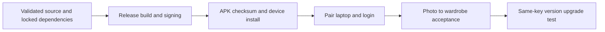

# OOTD-20 — Signed Android installation and upgrades

Version 1.0 · 20 October 2026 · Owner: Mobile/Release · Status: proposed; no APK built.

## 1. Overview and scope

Objective: deliver an installable Android app that connects to the laptop and updates without losing its identity/settings. Persona: owner installing an APK on a physical phone. Pain: debug-only builds, signing conflicts and an app that opens but cannot reach the server.

Verified: no Android/Flutter project was found in the inspected source set; F5 is a web prototype. The [Flutter Android release guide](https://docs.flutter.dev/deployment/android) documents signing, APK building and installation. Actual SDKs/toolchains/device compatibility are unverified.

In scope: release APK, signing identity, installation/upgrade, version compatibility, onboarding and operator runbook. Out: Play Store publication, automatic OTA updater, iOS build and bundling laptop ML models into the phone.

## 2. Requirements and acceptance

| Requirement | Acceptance criterion |
|---|---|
| FR1 Install a signed app | Release APK installs and launches on selected physical Android; release signing certificate is stable and privately retained. |
| FR2 Keep upgrade continuity | Same package/certificate and increasing version code upgrade preserves pairing, consent and permitted session storage; incompatible changes migrate explicitly. |
| FR3 Separate laptop workload | APK has no PostgreSQL credentials, model weights, personal PostHog key or server private key; AI executes on laptop. |
| FR4 Validate real network flow | Installed release build pairs, signs in, uploads, extracts, saves and reloads on same Wi-Fi through verified HTTPS. |
| FR5 Detect compatibility problems | Unsupported API version or unavailable laptop yields actionable screen, not crash/blank UI; core works without PostHog internet. |
| FR6 Provide reproducible handoff | Artifact version, package ID, SHA-256, signing certificate fingerprint, tested device and setup/start/backup instructions delivered. |

## 3. Installation and upgrade flow

Engineer runs validated build → signed APK+checksum → owner transfers APK → Android prompts install permission for chosen source → install → welcome/pair/login → acceptance journey. Upgrade uses same signing key; data migration runs before private content is shown.

No in-app installer or public artifact hosting API is required for v1.

## 4. Frontend/platform requirements

OOTD launcher name/icon and F5 light splash/home; final package ID supplied before first distributable build. Proposed minimum Android is the highest minimum required by tested Flutter/plugins, determined after inspecting target phone; do not promise every Android device. Record min/target/compile SDK and dependencies in release manifest.

Manifest permissions only for implemented features; system picker/capture permissions reflect chosen plugins and Android target behavior. Include network access and any required local-network permissions tested on target SDK/device. No release-wide certificate bypass or permissive debug HTTP exception.

Keep user-visible version in Settings. On incompatible API, explain to start/update laptop server. Uninstall loses phone-local pairing/session; wardrobe persists on laptop. Clear that new installation requires re-pair/login, not that photos were deleted.

## 5. Backend contracts and deployment requirements

Release uses existing proposed health/auth/feature APIs; no new install endpoint. Consumed examples:

| Request | Success | Failure |
|---|---|---|
| `GET /api/v1/health` over verified HTTPS, no auth/body | `200 {"server_id":"10000000-0000-4000-8000-000000000001","api_version":"1","status":"ready","ai_status":"ready"}` | `503 {"error":{"code":"SERVER_NOT_READY","message":"Start the laptop service and retry.","retryable":true},"request_id":"r-200"}` |
| `GET /api/v1/auth/me`, bearer, no body | `200 {"user_id":"20000000-0000-4000-8000-000000000001","username":"alex","display_name":"Alex","version":1,"analytics_consent":false,"consent_version":1,"timezone":"Asia/Kolkata"}` | `401 {"error":{"code":"SESSION_EXPIRED","message":"Please sign in again.","retryable":false},"request_id":"r-201"}` |

Release compatibility gate reads api_version from health before protected calls. Certificate failure is client-side connection failure. The Windows service starts API and one worker, loads configured private PostgreSQL/storage, reports DB and AI readiness separately, and runs without source prototype startup/cleanup side effects.

Provide start/stop instructions and logs location; no forced always-on background startup without owner choice. Laptop sleep/offline is a supported error condition. Configure private-network firewall scope for HTTPS service, never expose PostgreSQL to phone or public internet.

## 6. Build/data/security/observability

Proposed build layout: `android_app/mobile`, `server`, `database/migrations`, `docs`; actual implementation not created by these PRDs. Pin tested dependencies and model revisions; isolate development/test/production config and analytics projects.

Release signing secrets outside repository/artifacts; document secure backup and fingerprint. A debug key is not accepted as production release continuity. APK checksum computed after signing. Do not run generated build command against an uninitialized project and claim success.

Mobile schema migration is transactional and versioned; secure-storage corruption routes to login, not crash. Server data migrations require backup/rehearsal separately under19. Upgrade cannot silently change user/account UUID.

Proposed targets: cold first frame ≤2s, no memory crash on supported photo limit, full acceptance journey succeeds on physical LAN, unsigned/incorrect-key upgrade rejected by platform. APK size measured after build; no invented size promise.

Logs contain build/version/compatibility codes, no tokens. Release checklist captures crash-free test runs and server readiness; operator alerts for DB/worker failure already defined in owning features.

## 7. Analytics

No analytics before user consent merely because app installed. First-open/install estimates are first-observed launches, not proof of package installer success. Existing app session reset rules apply.

Envelope: event UUID/version/time, distinct/user ID or null, app session UUID, platform Android, app_version, screen_name, source client. No hardware serial/device advertising ID.

| Event | Trigger | Properties |
|---|---|---|
| `app_opened` | Consented launch/resume session | `launch_type:enum(cold,warm)`, `previous_app_version:nullable string` |
| `app_upgrade_observed` | First consented run after version change | `from_version:string`, `to_version:string`, `migration_result:enum` |
| `app_compatibility_failed` | Unsupported server/API | `error_code:enum`, `api_version:string` |
| `app_connection_retried` | Explicit retry from compatibility/error screen | `attempt:int` |

Example: `{"launch_type":"cold","previous_app_version":"0.1.0+1"}`. Events deduped by install/version/session where applicable; no fabricated installation-abandoned event from absent first launch. Local release testing records install failures independently of PostHog.

KPI: supported-device install/upgrade test pass rate100%; consented first-open→successful connection within24h. Production thresholds need a measured baseline.

## 8. Tests

| ID | Preconditions/data | Steps | Expected | Priority/type |
|---|---|---|---|---|
| T01 | Supported physical phone; signed APK | Install/launch | Correct icon/version, welcome works | P0 release/functional |
| T02 | Prior signed version with account/consent | Upgrade same key | Local state retained/migrated safely | P0 regression |
| T03 | Wrong signing key/package/version code | Attempt update | Platform rejection, installed data intact | P0 security |
| T04 | APK/static config scan | Inspect package | No DB password/model/admin keys/private key | P0 security |
| T05 | Real paired LAN/laptop | Run complete upload→save→suggest journey | Real correct end-to-end output | P0 integration |
| T06 | Laptop asleep/wrong Wi-Fi/incompatible API | Launch and retry | Clear recoverable states | P0 negative |
| T07 | Block internet to PostHog; models cached | Repeat core journey | Works; analytics queues or disabled | P0 offline |
| T08 | Local storage migration fails/corrupt token | Upgrade/relaunch | Safe login/recovery, no account leakage | P0 recovery |
| T09 | Reinstall, lowest supported device, text200% | Setup and navigate | Documented re-pair, accessible UI | P1 compatibility/UI |
| T10 | Cold start×20/largest image; consent checks | Benchmark and inspect | Targets, no crash, no unconsented lifecycle events | P1 performance/analytics |

FR1→T01/09; FR2→T02/03/08; FR3→T04; FR4→T05; FR5→T06/07; FR6→artifact/runbook review and T01/02.

## 9. Implementation and dependencies

Mobile/release: Flutter/Android SDK setup, package ID/icon, signing, locked build, checksum and device install/upgrade. Backend: reproducible local startup and compatibility readiness. Database:19 backup/migration. Analytics18 ensures consent-first lifecycle capture. QA executes all P0 core feature tests plus physical journey.

Inputs still needed at implementation: phone model/Android version, laptop resources, final package/app name and signing-key custody location. APK distribution is local/manual; Play Store fees/policy changes are not part of this deliverable.

## 10. Release readiness

- [ ] Signed APK physically installed and upgraded.
- [ ] Complete LAN journey passes with imported F5 owner.
- [ ] Package/version/checksum/certificate fingerprint recorded.
- [ ] No secrets/heavy models in APK; HTTPS trust works in release.
- [ ] Laptop startup, shutdown, sleep recovery and backup runbook tested.
- [ ] Open device/branding/key decisions resolved before distribution.
